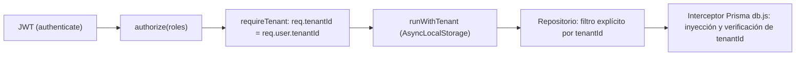

# Seguridad, Multi-Tenancy y LOPDP — Norma ERP

Presupone `erp-ingenieria-software` y `erp-backend`. Se combina con la skill global `datos-seguros`: no modificar credenciales, permisos ni configuraciones de seguridad sin orden explícita.

---

## 1. Modelo de Aislamiento (Defensa en Profundidad)

| Capa | Archivo | Garantía |
|---|---|---|
| Autenticación | `modules/auth/auth.middleware.js` | `req.user` desde JWT firmado |
| Autorización | `authorize([...])` + `config/roles.js` (`ROLES`, `ROLE_PERMISSIONS`) | Rol suficiente para la ruta |
| Contexto tenant | `modules/tenants/organization/tenant.middleware.js` | `tenantId` del token (nunca de cabecera para usuarios de tenant), suscripción activa |
| Contexto asíncrono | `database/tenantContext.js` | `getTenantId()` disponible en toda la cadena |
| Repositorio | `*.repository.js` | Filtro explícito por `tenantId` (primera línea de defensa en datos) |
| Interceptor | `database/db.js` | Red de seguridad: inyecta `tenantId` y verifica pertenencia antes de `update`/`delete` |

Reglas:

1. **El `tenantId` proviene exclusivamente de `req.tenantId`** (establecido por `requireTenant`). Prohibido aceptar `tenantId` desde `body`, `query` o cabeceras en rutas de tenant.
2. **Doble filtro obligatorio:** el repositorio filtra por `tenantId` aunque el interceptor también lo haga.
3. **Modelos nuevos** se registran en los conjuntos del interceptor (`DIRECT_TENANT_MODELS`, `EMPLOYEE_RELATION_MODELS`, `INDIRECT_RELATION_MAP`).
4. **Acceso propio vs gestión:** un `employee` solo opera sus registros (`req.user.employeeId`); `admin`/`hr`/`manager` operan sobre el tenant según `ROLE_PERMISSIONS`.
5. **Pruebas de aislamiento** obligatorias en funcionalidades nuevas con datos de tenant: verificar que un recurso de otro tenant responde 404/403 (referencia: `tests/modules/tenants/tenantRoleIsolation.test.js`, `tests/modules/recruitment/recruitmentMultiTenant.test.js`).

---

## 2. Roles y Superadmin

| Rol | Alcance |
|---|---|
| `superadmin` | Plataforma: empresas, planes, métricas globales, auditoría global. **Sin acceso a datos operativos ni personales de tenants** |
| `admin` | Administración completa de su tenant |
| `hr` | Talento humano, nómina, asistencia de su tenant |
| `accounting` | Contabilidad y reportes financieros de su tenant |
| `manager` | Su equipo |
| `employee` | Autogestión (portal) |

* Rutas de plataforma usan `superAdmin.middleware.js`; rutas operativas nunca deben abrirse a `superadmin`.
* En frontend, `RequireAuth` redirige a `superadmin` a `/superadmin/dashboard`; no reintroducir selectores de empresa ni cabecera `x-tenant-id` en `httpClient`.
* Deuda vigente: `authorize` concede bypass a `superadmin` y `requireTenant` conserva un modo lectura por `x-tenant-id`. No ampliar ese comportamiento; su eliminación es una tarea registrada.

---

## 3. Datos Personales y Cifrado (LOPDP)

| Dato | Tratamiento |
|---|---|
| Salario | `encryptSalary` al persistir, `decryptSalary` solo en el servicio que lo necesita; nunca en logs ni respuestas de listados masivos sin permiso `payroll:read` |
| Coordenadas de geocerca / marcaciones | `encryptCoordinate` / `decryptCoordinate` |
| Cédula, teléfono, dirección, cuenta bancaria | Proyección mínima por rol; enmascarado en UI (`MaskedText`) |
| Contraseñas | `bcryptjs`; nunca seleccionadas en consultas de lectura |
| OTP / códigos | Hash SHA-256 + `crypto.timingSafeEqual`, TTL, límite de intentos (referencia: `whatsappConfirmation.service.js`) |

* Prohibido registrar `req.body`, tokens, salarios o documentos de identidad en logs.
* Agregados analíticos (ODS 8, inteligencia) se calculan por `tenantId`; nunca agregaciones cruzadas entre tenants con datos descifrados.
* Exportaciones (CSV/PDF) respetan el mismo RBAC que la vista.

---

## 4. Secretos y Configuración

* Variables sensibles: `JWT_SECRET`, `ENCRYPTION_KEY` (32 bytes hex), `SEED_SECRET`, `WHATSAPP_APP_SECRET`, `WHATSAPP_ACCESS_TOKEN`, claves LLM (`DEEPSEEK_API_KEY`, `GEMINI_API_KEY`, ...), `HF_TOKEN`, `EMAIL_PASS`.
* **Fail-fast:** las variables obligatorias se validan al arrancar en `config/env.js`; prohibido `process.env.X || 'valor-por-defecto'` para secretos (10 casos legados registrados).
* `.env` nunca se versiona; `.env.example` contiene solo nombres y placeholders. `secretlint` corre en `pre-commit` y en CI.
* Rotación de `ENCRYPTION_KEY` requiere script de re-cifrado planificado; nunca cambiarla en caliente.

---

## 5. Superficies Externas

| Superficie | Control obligatorio |
|---|---|
| Webhook WhatsApp | Firma `x-hub-signature-256` HMAC-SHA256 con `WHATSAPP_APP_SECRET`, idempotencia por `message.id`, rate limit por teléfono |
| WebAuthn | `RP_ID` y `ORIGIN` desde entorno; verificación con `@simplewebauthn/server` |
| Carga de archivos | `core/storage/upload.middleware.js` con límite de tamaño y lista blanca de MIME |
| Firma electrónica `.p12` | Certificado y contraseña nunca persistidos en texto plano |
| CORS / Helmet / Rate limit | Configurados en `app.js` y `core/middleware/rateLimit.middleware.js`; no relajar sin justificación |

---

## 6. Auditoría

* Toda acción sensible (aprobación de nómina, cambios salariales, cierre de periodo contable, terminación laboral, cambios de rol) registra `AuditLog` mediante `auditRepository` del dominio `audit` con `tenantId`, `userId`, acción, entidad y diferencia relevante (sin PII innecesaria).

---

## 7. Lista de Verificación de Seguridad por Cambio

- [ ] `tenantId` obtenido de `req.tenantId`, filtrado en repositorio y modelo registrado en `db.js`.
- [ ] Ruta con `authenticate`, `authorize` con roles mínimos y `requireTenant` si aplica.
- [ ] Prueba de aislamiento entre tenants y de rol insuficiente.
- [ ] Sin PII ni secretos en logs, respuestas o mensajes de error.
- [ ] Datos sensibles cifrados y proyectados por rol.
- [ ] Acciones sensibles auditadas.
- [ ] Nuevas variables documentadas en `.env.example` y en `docs/07-despliegue-y-operaciones/`.

