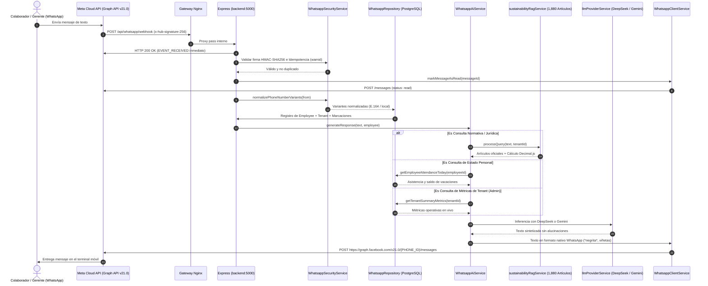

# Especificación Técnica: Asistente Corporativo WhatsApp Cloud API con DeepSeek, Gemini y RAG Legal

Este documento especifica la arquitectura de integración, flujos de eventos de webhooks, validaciones criptográficas, RBAC multi-tenant y orquestación de modelos de lenguaje (DeepSeek y Google Gemini) para el canal conversacional de WhatsApp en **Norma ERP**.

---

## 1. Arquitectura de Integración y Flujo de Datos

El módulo [`backend/src/modules/whatsapp/`](../../backend/src/modules/whatsapp/) desacopla la capa de transporte provista por Meta Cloud API de la capa de inteligencia de negocio y de los modelos fundacionales de lenguaje.



---

## 2. Inventario de Componentes del Bounded Context

| Componente                        | Archivo Fuente                                                                                                              | Responsabilidad                                                                                                            |
| :-------------------------------- | :-------------------------------------------------------------------------------------------------------------------------- | :------------------------------------------------------------------------------------------------------------------------- |
| **Constantes y Prompts**          | [`whatsapp.constants.js`](../../backend/src/modules/whatsapp/whatsapp.constants.js)                                         | Textos predeterminados, intenciones soportadas y restricciones visuales para WhatsApp.                                     |
| **Seguridad y Criptografía**      | [`whatsappSecurity.service.js`](../../backend/src/modules/whatsapp/whatsappSecurity.service.js)                             | Validación HMAC-SHA256 de webhooks, normalización de prefijos E.164, prevención de duplicados con TTL y rate limiting.     |
| **Cliente Meta Graph API**        | [`whatsappClient.service.js`](../../backend/src/modules/whatsapp/whatsappClient.service.js)                                 | Cliente HTTP con fragmentación automática de mensajes mayores a 4,000 caracteres y confirmación de lectura.                |
| **Persistencia y Acceso a Datos** | [`whatsapp.repository.js`](../../backend/src/modules/whatsapp/whatsapp.repository.js)                                       | Resolución multi-tenant canónica de colaboradores, conmutación de empresa, marcaciones del día y métricas.                 |
| **Sesiones Agénticas (Prisma)**   | [`whatsappActionSession.repository.js`](../../backend/src/modules/whatsapp/whatsappActionSession.repository.js)             | Persistencia multi-tenant de borradores multi-turno, intentos 2FA y reclamo atómico idempotente (`WhatsappActionSession`). |
| **Confirmación Dual 2FA**         | [`whatsappConfirmation.service.js`](../../backend/src/modules/whatsapp/whatsappConfirmation.service.js)                     | Generación de OTP SHA-256 enviado por correo SMTP, validación con cédula completa y registro en `AuditLog`.                |
| **Historial y Contexto IA**       | [`whatsappConversationHistory.service.js`](../../backend/src/modules/whatsapp/whatsappConversationHistory.service.js)       | Ventana deslizante (6 mensajes), caducidad TTL (15 min), aislamiento multi-tenant y reseteo explícito.                     |
| **Persistencia de Contexto**      | [`whatsappConversationHistory.repository.js`](../../backend/src/modules/whatsapp/whatsappConversationHistory.repository.js) | Persistencia en `whatsapp_conversation_contexts` (`conversationHistoryJson` y `lastInteractionAt`).                        |
| **Consentimiento LOPDP**          | [`whatsappConsent.service.js`](../../backend/src/modules/whatsapp/whatsappConsent.service.js)                               | Control de consentimiento previo obligatorio (ACEPTO), revocatoria incondicional (REVOCAR) y auditoría LOPDP.              |
| **Registro de Habilidades**       | [`skills/whatsappSkill.registry.js`](../../backend/src/modules/whatsapp/skills/whatsappSkill.registry.js)                   | Registro desacoplado de capacidades transaccionales (Agent Skills) ejecutables desde WhatsApp.                             |
| **Habilidad: Vacaciones**         | [`skills/requestVacation.skill.js`](../../backend/src/modules/whatsapp/skills/requestVacation.skill.js)                     | Extracción estructurada de fechas/motivo, pre-validación en `absenceService.previewVacationRequest` y creación `PENDING`.  |
| **Orquestador de IA**             | [`whatsappAi.service.js`](../../backend/src/modules/whatsapp/whatsappAi.service.js)                                         | Enrutamiento de intención, gestión de sesiones agénticas activas, conexión con DeepSeek/Gemini y limpieza de formato.      |
| **Coordinador del Webhook**       | [`whatsapp.service.js`](../../backend/src/modules/whatsapp/whatsapp.service.js)                                             | Handshake de suscripción, procesamiento desacoplado en segundo plano y diagnóstico del canal.                              |
| **Controlador HTTP**              | [`whatsapp.controller.js`](../../backend/src/modules/whatsapp/whatsapp.controller.js)                                       | Endpoints de webhook público y utilidades administrativas de diagnóstico y prueba.                                         |
| **Enrutador**                     | [`whatsapp.routes.js`](../../backend/src/modules/whatsapp/whatsapp.routes.js)                                               | Exposición canónica en `/api/whatsapp`.                                                                                    |

---

## 3. Endpoints de la API REST

### 3.1. Handshake de Suscripción (Público Meta)

- **Método:** `GET`
- **Ruta:** `/api/whatsapp/webhook`
- **Parámetros de Query:**
  - `hub.mode`: Debe ser `subscribe`.
  - `hub.verify_token`: Debe coincidir con `WHATSAPP_VERIFY_TOKEN`.
  - `hub.challenge`: Cadena aleatoria enviada por Meta.
- **Respuesta Exitosa:** HTTP `200` con el contenido plano de `hub.challenge`.

### 3.2. Receptor de Mensajes y Eventos (Público Meta)

- **Método:** `POST`
- **Ruta:** `/api/whatsapp/webhook`
- **Cabeceras:** `x-hub-signature-256` (Firma HMAC calculada con `WHATSAPP_APP_SECRET`).
- **Respuesta Exitosa:** HTTP `200 OK` con texto `EVENT_RECEIVED` (respuesta inmediata para cumplir con el SLA de Meta < 5 segundos).

### 3.3. Diagnóstico de Infraestructura y Configuración

- **Método:** `GET`
- **Ruta:** `/api/whatsapp/status`
- **Seguridad:** Requiere cabecera `Authorization: Bearer <JWT>` con rol `admin` o `superadmin`.
- **Respuesta de Ejemplo:**

```json
{
  "whatsapp": {
    "isConfigured": true,
    "phoneNumberId": "1055***",
    "hasAccessToken": true,
    "verifyTokenConfigured": true,
    "appSecretConfigured": true
  },
  "ai": {
    "activeProvider": "deepseek",
    "model": "deepseek-chat",
    "deepseekConfigured": true,
    "geminiConfigured": true
  }
}
```

### 3.4. Envío de Mensaje de Prueba

- **Método:** `POST`
- **Ruta:** `/api/whatsapp/test`
- **Seguridad:** Requiere cabecera `Authorization: Bearer <JWT>` con rol `admin` o `superadmin`.
- **Cuerpo de Petición:**

```json
{
  "to": "593987654321",
  "text": "Prueba de canal WhatsApp Norma ERP."
}
```

---

## 4. Guía de Puesta en Producción en Meta for Developers

1. **Creación de la Aplicación en Meta:**
   - Crear una aplicación de tipo **Business** en [Meta for Developers](https://developers.facebook.com/).
   - Agregar el producto **WhatsApp**.
2. **Configuración de la API:**
   - Obtener el **Phone Number ID** desde la pestaña _API Setup_.
   - Generar un **System User Access Token** permanente en el Business Manager con el permiso `whatsapp_business_messaging`.
3. **Configuración del Webhook:**
   - **Callback URL:** `https://norma.doicela.dev/api/whatsapp/webhook`
   - **Verify Token:** El valor exacto asignado a `WHATSAPP_VERIFY_TOKEN` en el archivo `.env`.
   - **Campos de Suscripción:** Marcar la casilla `messages`.
4. **Asignación de Variables de Entorno en `.env`:**
   ```bash
   WHATSAPP_PHONE_NUMBER_ID="tu_phone_number_id"
   WHATSAPP_ACCESS_TOKEN="tu_access_token_permanente"
   WHATSAPP_VERIFY_TOKEN="norma_erp_whatsapp_verify_secret_2026"
   WHATSAPP_APP_SECRET="tu_app_secret_de_meta"
   WHATSAPP_AI_PROVIDER="deepseek" # o "gemini"
   DEEPSEEK_API_KEY="sk-..."
   GEMINI_API_KEY="AIza..."
   ```

---

## 5. Habilidades Agénticas Transaccionales y Seguridad Multi-Tenant (2FA)

Las acciones de escritura desde WhatsApp (como solicitar vacaciones vía `REQUEST_VACATION`) operan bajo un flujo **Human-in-the-Loop** con aislamiento estricto por `tenantId`:

0. **Consentimiento Previo y Revocatoria LOPDP (Arts. 8, 12 y 15):** Antes de procesar cualquier consulta operativa, saludo o habilidad agéntica, `WhatsappConsentService` verifica que el colaborador posea consentimiento activo (`employee.whatsappConsent === true`). Si no lo tiene, se bloquea la interacción presentando el enlace público a las políticas de privacidad (`/privacy`) y solicitando responder con la palabra `ACEPTO`. Asimismo, el titular puede revocar su consentimiento en cualquier momento enviando `REVOCAR`, cancelando sesiones activas y registrando la trazabilidad en `audit_logs` (`WHATSAPP_LOPDP_CONSENT_GRANTED` / `WHATSAPP_LOPDP_CONSENT_REVOKED`).
1. **Resolución Multi-Tenant del Remitente:** Si un número telefónico pertenece a colaboradores activos en múltiples empresas, `WhatsappRepository.resolveEmployeeContext` requiere selección explícita (`WhatsappConversationContext`) antes de consultar o mutar información operativa. El usuario puede alternar empresa con `CAMBIAR EMPRESA`.
2. **Pre-validación de Dominio:** `RequestVacationSkill` extrae `startDate`, `endDate` y `reason` (multi-turno si falta información) y ejecuta `absenceService.previewVacationRequest`, validando fechas futuras en `America/Guayaquil`, ausencia de solapamientos y saldo neto (`vacationDays` descontando solicitudes `PENDING`).
3. **Doble Factor (Cédula Completa + OTP SMTP):** `WhatsappConfirmationService` almacena un borrador en `whatsapp_action_sessions` con vigencia de 10 minutos, máximo 3 intentos y código OTP de 6 dígitos enviado vía `EmailService` (almacenado únicamente como hash SHA-256 con salt de sesión).
4. **Ejecución Idempotente y Auditoría:** Al recibir `CONFIRMAR <cedula_completa> <OTP_6_digitos>`, se valida en tiempo constante (`crypto.timingSafeEqual`), se reclama la sesión atómicamente (`PENDING_CONFIRMATION -> EXECUTING`), se registra la solicitud en `AbsenceRequest` (`status: PENDING`), se notifica a administradores del tenant y se escribe trazabilidad en `audit_logs`.

---

## 6. Seguimiento de Contexto Conversacional con Ventana Deslizante y TTL

Para posibilitar repreguntas sobre legislación laboral ecuatoriana y consultas de perfil personal sin desbordar tokens ni provocar derivas conversacionales en WhatsApp, el sistema incorpora `WhatsappConversationHistoryService`:

1. **Ventana Deslizante Acotada:** Almacena un máximo de **6 mensajes (3 turnos completos)** en formato `{ role: 'user' | 'assistant', content: string, timestamp: string }`. Todo turno adicional descarta progresivamente los mensajes más antiguos, garantizando predictibilidad de memoria y costos controlados de inferencia.
2. **TTL Estricto por Inactividad (15 Minutos):** WhatsApp es un canal asíncrono. Si entre dos mensajes transcurren más de 15 minutos (`WHATSAPP_CONVERSATION_HISTORY_TTL_MS`), el contexto se purga automáticamente antes de procesar el nuevo mensaje, evitando asociar erróneamente consultas de días o semanas previas.
3. **Aislamiento Multi-Tenant Estricto:** Vinculado al `activeTenantId`. Si un colaborador con acceso a múltiples empresas cambia de empresa activa mediante `CAMBIAR EMPRESA`, el historial de la empresa previa es purgado de inmediato para prevenir fuga de datos inter-empresariales.
4. **Comandos de Reseteo Explícito:** El colaborador puede restablecer el contexto en cualquier momento enviando comandos como _"nueva consulta"_, _"olvida lo anterior"_, _"reiniciar conversación"_ o _"empezar de nuevo"_. El sistema limpia el contexto y confirma: _"Conversación reiniciada correctamente. He limpiado el contexto previo. ¿En qué le puedo colaborar ahora?"_.
5. **Gobernanza LOPDP:** La revocatoria de consentimiento (`REVOCAR`) purga automáticamente el historial de conversación en `whatsapp_conversation_contexts`.
6. **Persistencia Transaccional:** La estructura se persiste en `whatsapp_conversation_contexts` bajo las columnas `conversationHistoryJson` (JSONB) y `lastInteractionAt` (TIMESTAMP). Si la base de datos experimenta latencia o indisponibilidad transitoria, el servicio degrada de manera suave y no bloquea el despacho de respuestas.

---

## 7. Delimitación de Capacidades y Manejo Fuera de Alcance (Out of Scope)

Para evitar derivas al RAG normativo cuando los usuarios solicitan acciones o temas no contemplados en el ERP:

1. **Clasificación Estricta de Dominio:** El enrutador `classifyIntent` en `whatsappAi.utils.js` distingue positivamente consultas laborales ecuatorianas (`LEGAL_QUERY`) de temas ajenos (clima, compras, facturación web, deportes, cocina o tareas generales).
2. **Respuesta Informativa Estructurada:** Las peticiones no autorizadas o ajenas al canal WhatsApp reciben `OUT_OF_SCOPE_MESSAGE`, que delimita explícitamente las cuatro fronteras operativas del sistema (Gestión 2FA, Consultas Personales, Legislación Laboral y Multi-Empresa), sugiriendo escribir `AYUDA` o `MENU` para ver ejemplos de uso.
