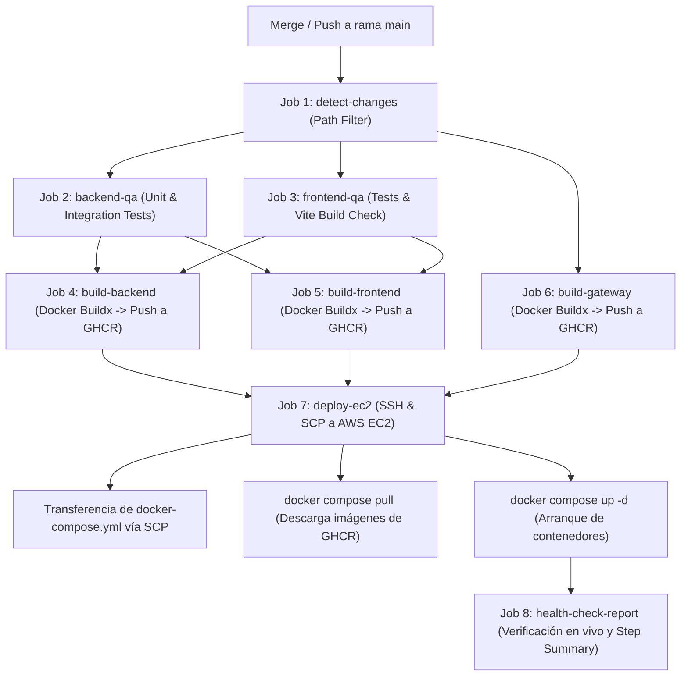

# 05 — Infraestructura Docker y Despliegue en AWS

## 1. Arquitectura de Contenedores

El sistema opera con 5 contenedores orquestados mediante Docker Compose bajo un patrón de Reverse Proxy & API Gateway perimetral:

```
┌────────────────────────────────────────────────────────────────────────┐
│ Red Interna: rh_network (bridge)                                       │
│                                                                        │
│                                       ┌─────────────────────────────┐  │
│                                       │ Frontend Web (React SPA)    │  │
│                                       │ :80 (interno)               │  │
│                                  ┌───►│ (rh_frontend)               │  │
│                                  │    └─────────────────────────────┘  │
│  ┌───────────────────────┐       │                                     │
│  │ Gateway Nginx         │───────┤                                     │
│  │ :80 / :443 (SSL/TLS)  │       │    ┌─────────────────────────────┐  │
│  │ (rh_gateway)          │───────┼───►│ Node.js Backend API         │  │
│  └───────────────────────┘       │    │ :5000                       │  │
│                                  │    │ (rh_backend)                │  │
│                                  │    └──────┬──────────────────────┘  │
│                                  │           │                         │
│                                  │    ┌──────▼──────┐   ┌───────────┐  │
│                                  │    │ PostgreSQL  │   │  Redis    │  │
│                                  └───►│ :5432       │   │  :6379    │  │
│                                       │(rh_postgres)│   │ (rh_redis)│  │
│                                       └─────────────┘   └───────────┘  │
└────────────────────────────────────────────────────────────────────────┘
```

## 2. Servicios Docker Compose

### 2.1 Base de Datos PostgreSQL

```yaml
db:
  image: postgres:15-alpine
  container_name: rh_postgres
  restart: always
  healthcheck:
    test: ['CMD-SHELL', 'pg_isready -U ${POSTGRES_USER} -d ${POSTGRES_DB}']
    interval: 5s
    timeout: 5s
    retries: 5
  volumes:
    - postgres_data:/var/lib/postgresql/data
```

El volumen `postgres_data` persiste los datos de PostgreSQL fuera del ciclo de vida del contenedor.

### 2.2 Caché Redis

```yaml
redis:
  image: redis:7-alpine
  container_name: rh_redis
  restart: always
  healthcheck:
    test: ['CMD', 'redis-cli', 'ping']
```

Redis gestiona en memoria el estado de WebSockets y la caché de sesiones.

### 2.3 Backend API

```yaml
backend:
  build: ./backend
  container_name: rh_backend
  restart: always
  environment:
    PORT: 5000
    DATABASE_URL: postgresql://...@db:5432/...
    REDIS_URL: redis://redis:6379
    JWT_SECRET: ...
    ENCRYPTION_KEY: ...
    RP_ID: doicela.dev
  healthcheck:
    test: ['CMD-SHELL', 'curl -sf http://localhost:5000/health || exit 1']
    interval: 30s
    timeout: 10s
    retries: 3
    start_period: 90s
  volumes:
    - uploads_data:/app/uploads
  depends_on:
    db:
      condition: service_healthy
    redis:
      condition: service_healthy
```

El `start_period: 90s` concede tiempo suficiente para que Prisma ejecute migraciones pendientes al iniciar. El healthcheck usa el endpoint `/health` del backend. El volumen `uploads_data` persiste los archivos subidos.

### 2.4 Frontend Web SPA

```yaml
frontend:
  build: ./frontend
  container_name: rh_frontend
  restart: always
  expose:
    - '80'
  networks:
    - rh_network
```

El contenedor frontend sirve los activos estáticos compilados de la SPA de React mediante un Nginx interno optimizado para servir archivos en caché inmutable y resolver rutas con `try_files $uri $uri/ /index.html`. No expone puertos al exterior; solo es accesible internamente por el Gateway.

### 2.5 Reverse Proxy & API Gateway (Nginx)

```yaml
gateway:
  build: ./nginx
  container_name: rh_gateway
  restart: always
  ports:
    - '80:80'
    - '443:443'
  volumes:
    - /var/www/recursos_humanos/certs:/etc/nginx/certs:ro
  depends_on:
    backend:
      condition: service_healthy
    frontend:
      condition: service_started
  networks:
    - rh_network
```

El Gateway perimetral centraliza la entrada externa:

- Maneja la terminación SSL/TLS (HTTPS) y redirección obligatoria desde HTTP (puerto 80).
- Despacha el tráfico hacia `http://frontend:80` para la interfaz de usuario.
- Enruta `/api/*` y `/uploads/*` hacia `http://backend:5000`.
- Establece canales bidireccionales persistentes para WebSockets en `/socket.io/`.
- Aplica compresión Gzip perimetral y sanitización de encabezados.

## 3. Dockerfile del Backend

El proceso de build del backend:

1. `node:20-alpine` como imagen base (ligera).
2. `COPY package*.json ./` + `npm ci --only=production` para instalar dependencias de producción.
3. `npx prisma generate` en el postinstall para generar el cliente Prisma.
4. `COPY . .` para copiar el código fuente.
5. `CMD ["node", "src/server.js"]` como comando de inicio.

Al arrancar, el servidor ejecuta `npx prisma migrate deploy` antes de iniciar Express para aplicar migraciones pendientes de forma automática en el entorno productivo.

## 4. Dockerfile del Frontend

1. **Build stage:** `node:20-alpine` para ejecutar `npm run build` (Vite produce `dist/`).
2. **Serve stage:** `nginx:alpine` para servir exclusivamente los activos estáticos del directorio `dist/`.

## 5. Módulo Nginx Gateway (`/nginx`) y Terminación SSL

El Gateway desacoplado en `/nginx` contiene:

- `conf.d/default.conf`: Configuración del servidor virtual perimetral, SSL, timeouts, buffers y enrutamiento hacia frontend y backend.
- `docker-entrypoint.sh`: Verificación y generación de certificados autofirmados de respaldo si no existen en `/etc/nginx/certs`.
- `Dockerfile`: Empaqueta la imagen perimetral basada en `nginx:alpine` y utilitarios criptográficos.

## 6. Integración con Cloudflare y Arquitectura SSL/TLS

El sistema opera detrás del proxy perimetral de **Cloudflare**, lo cual optimiza la entrega de tráfico y simplifica la gestión criptográfica:

```
Navegador Cliente
      │  HTTPS (Certificado CA Público de Cloudflare - Válido para WebAuthn)
      ▼
Cloudflare Edge Proxy (Modo SSL/TLS: Full)
      │  HTTPS (Puerto 443 hacia Origin EC2)
      ▼
Host AWS EC2 (rh_gateway Nginx)
      │  - Certificado autofirmado generado por entrypoint.sh (o Cloudflare Origin CA)
      │  - Redirección automática de puerto 80 a 443
      ▼
Red Interna Docker (rh_network) -> rh_backend (:5000) / rh_frontend (:80)
```

### Directrices de Configuración Cloudflare:

- **Modo SSL/TLS: Full (recomendado en etapa inicial):** Cloudflare cifra la conexión hacia el origen en el puerto `443` aceptando el certificado autofirmado generado automáticamente por el contenedor [`rh_gateway`](file:///C:/Users/DESARROLLADOR/Desktop/Proyectos/erp_pymes/nginx/docker-entrypoint.sh). No se requiere instalar Certbot ni ejecutar tareas programadas de renovación en el servidor.
- **Incompatibilidad de Modo Flexible:** Queda terminantemente prohibido configurar el modo _Flexible_. La directiva `return 301 https://$host$request_uri;` en el puerto `80` de Nginx generará un bucle infinito de redirecciones (`ERR_TOO_MANY_REDIRECTS`).
- **Modo Full (Strict) con Cloudflare Origin CA:** Para validar certificados de forma estricta sin Certbot, se genera un certificado de origen con 15 años de validez desde el dashboard de Cloudflare y se almacena en `/var/www/recursos_humanos/certs/cert.pem` y `key.pem`.

## 7. Variables de Entorno de Producción

| Variable          | Descripción                                                                                 |
| ----------------- | ------------------------------------------------------------------------------------------- |
| `DATABASE_URL`    | URI completa de PostgreSQL (incluye host `db`, puerto, usuario, contraseña y base de datos) |
| `REDIS_URL`       | URI de Redis (`redis://redis:6379`)                                                         |
| `JWT_SECRET`      | Clave secreta para firmar JWT (mínimo 64 caracteres en producción)                          |
| `ENCRYPTION_KEY`  | Clave hex de 32 bytes para AES-256-GCM (datos sensibles)                                    |
| `RP_ID`           | Relying Party ID para WebAuthn (dominio base sin protocolo: `doicela.dev`)                  |
| `ALLOWED_ORIGINS` | Lista de dominios HTTPS permitidos para CORS y WebAuthn                                     |
| `CLIENT_URL`      | URL del frontend para redirecciones de correo (restablecimiento de contraseña)              |
| `EMAIL_USER`      | Correo de envío para Nodemailer                                                             |
| `EMAIL_PASS`      | Contraseña de aplicación del correo (no la contraseña personal)                             |
| `SEED_SECRET`     | Clave para proteger el endpoint `/api/seed`                                                 |

## 8. Healthcheck y Resiliencia

- `restart: always` en todos los servicios garantiza reinicio automático en caso de crash.
- El backend depende de PostgreSQL y Redis con `condition: service_healthy`, garantizando que no intente conectarse antes de que estén listos.
- El frontend depende del backend con `condition: service_healthy`, garantizando que Nginx no sirva peticiones de API antes de que el backend esté disponible.
- El endpoint `/health` del backend responde sin consultar la base de datos, retornando solo el status del proceso Node.js.

## 9. Dominio y Topología de Producción

El sistema está desplegado en:

- **Dominio:** `https://norma.doicela.dev`
- **Servidor:** AWS EC2 sobre **Debian GNU/Linux** (AMI oficial Debian con usuario `admin`)
- **Proxy Perimetral:** Cloudflare + Nginx Gateway (SSL/TLS 443)
- **Base de datos:** PostgreSQL 15 en contenedor con volumen persistente `postgres_data`
- **Caché:** Redis 7 en contenedor con volumen `redis_data`
- **Archivos:** Almacenamiento local persistente en volumen `uploads_data`

## 10. Pipeline Automatizado de Despliegue CI/CD (GitHub Actions)

El despliegue a producción en AWS EC2 está **100% automatizado** mediante el workflow [`.github/workflows/deploy.yml`](file:///C:/Users/DESARROLLADOR/Desktop/Proyectos/erp_pymes/.github/workflows/deploy.yml).

### Flujo de Ejecución (Disparado por Push o Merge a `main`):



### Características del Despliegue Automatizado:

1. **Compilación en Runners de GitHub:** La construcción pesada de imágenes Docker y el bundling de Vite ocurren en los servidores de GitHub Actions, liberando de carga de CPU y memoria al servidor EC2.
2. **Registry Privado (GHCR):** Las imágenes versionadas por SHA y tag `latest` se publican en `ghcr.io`.
3. **Inyección de Migraciones Automáticas:** Al iniciar el contenedor `rh_backend`, su [`entrypoint.sh`](file:///C:/Users/DESARROLLADOR/Desktop/Proyectos/erp_pymes/backend/entrypoint.sh) ejecuta `prisma migrate deploy` antes de levantar Express, aplicando los cambios de esquema sin intervención manual.
4. **Modo Reinicio Rápido:** El workflow permite ejecución manual (`workflow_dispatch`) con el parámetro `restart_only: true` para mitigar errores 502 reiniciando contenedores en caliente sin recompilar imágenes.

## 11. Procedimiento de Rollback Inmediato

Ante incidentes en producción, se dispone del workflow automatizado [`.github/workflows/rollback.yml`](file:///C:/Users/DESARROLLADOR/Desktop/Proyectos/erp_pymes/.github/workflows/rollback.yml):

1. Acceder a **GitHub Actions -> Rollback - Instant AWS EC2 Deployment**.
2. Hacer clic en **Run workflow**.
3. Ingresar el commit SHA objetivo (o tag `latest`).
4. El pipeline conecta por SSH al servidor, reasigna las imágenes Docker correspondientes al SHA indicado, descarga las capas desde GHCR y levanta el servicio en menos de 60 segundos sin recompilar código.

## 12. Aprovisionamiento Inicial del Servidor Host (Debian GNU/Linux Bootstrap)

El entorno de ejecución host de referencia para AWS EC2 es **Debian GNU/Linux** (usuario del sistema: `admin`).

Antes del primer despliegue automatizado, el servidor host se aprovisiona con los siguientes comandos ejecutados una sola vez:

```bash
# 1. Instalación de Docker Engine y Docker Compose V2 en Debian
curl -fsSL https://get.docker.com -o get-docker.sh
sudo sh get-docker.sh

# 2. Habilitar servicio Docker y membresía del usuario admin
sudo systemctl enable --now docker
sudo usermod -aG docker $USER
newgrp docker

# 3. Deshabilitar Nginx del host si existiera para liberar puertos 80 y 443
sudo systemctl stop nginx 2>/dev/null || true
sudo systemctl disable nginx 2>/dev/null || true

# 4. Configurar 2 GB de memoria Swap (resiliencia de memoria)
sudo fallocate -l 2G /swapfile
sudo chmod 600 /swapfile
sudo mkswap /swapfile
sudo swapon /swapfile
echo '/swapfile none swap sw 0 0' | sudo tee -a /etc/fstab

# 5. Estructura de directorios con propiedad para el usuario admin
sudo mkdir -p /var/www/recursos_humanos/certs /var/www/recursos_humanos/backups
sudo chown -R $USER:$USER /var/www/recursos_humanos

# 6. Creación directa del archivo de entorno de producción
cat << 'EOF' > /var/www/recursos_humanos/.env
NODE_ENV=production
PORT=5000

# Registro de Imágenes GHCR
BACKEND_IMAGE=ghcr.io/jorgedoicela/rh-backend:latest
FRONTEND_IMAGE=ghcr.io/jorgedoicela/rh-frontend:latest
GATEWAY_IMAGE=ghcr.io/jorgedoicela/rh-gateway:latest

# Base de Datos PostgreSQL
POSTGRES_USER=admin_rh
POSTGRES_PASSWORD=password
POSTGRES_DB=db_recursos_humanos
DATABASE_URL="postgresql://admin_rh:password@db:5432/db_recursos_humanos?schema=public"

# Cache Redis
REDIS_URL="redis://redis:6379"

# Claves Criptográficas Maestras (Generar con: openssl rand -hex 32)
JWT_SECRET=CAMBIAR_POR_HEX_DE_64_CARACTERES
ENCRYPTION_KEY=CAMBIAR_POR_HEX_DE_32_BYTES
SEED_SECRET=CAMBIAR_POR_CLAVE_SEED
RUN_SEED=true

# Dominios y Seguridad WebAuthn
CLIENT_URL="https://norma.doicela.dev"
FRONTEND_URL="https://norma.doicela.dev"
ORIGIN="https://norma.doicela.dev"
APP_URL="https://norma.doicela.dev"
RP_ID="doicela.dev"
ALLOWED_ORIGINS="https://norma.doicela.dev"
BIOMETRIC_MAX_AGE_DAYS=90

# Notificaciones por Correo SMTP
EMAIL_USER="contacto@doicela.dev"
EMAIL_PASS="tu-app-password-smtp"
EOF
```

### Reglas de Firewall y Red (AWS Security Groups):

| Puerto | Protocolo | Origen permitido     | Función                                                      |
| :----- | :-------- | :------------------- | :----------------------------------------------------------- |
| `22`   | TCP       | IP de administración | Acceso SSH seguro                                            |
| `80`   | TCP       | `0.0.0.0/0`          | HTTP (Redirección obligatoria a HTTPS por Nginx Gateway)     |
| `443`  | TCP       | `0.0.0.0/0`          | HTTPS (Tráfico perimetral de Cloudflare hacia Nginx Gateway) |

_Nota de seguridad estricta:_ Los puertos `5432` (PostgreSQL), `6379` (Redis) y `5000` (Backend API) no deben abrirse en el Security Group de AWS. Permanecen confinados exclusivamente dentro de la red privada bridge `rh_network` de Docker.

### Secretos Requeridos en GitHub Repository:

Para la conexión SSH automatizada de GitHub Actions hacia la instancia Debian de AWS EC2:

| Secreto en GitHub | Valor requerido                                                      |
| :---------------- | :------------------------------------------------------------------- |
| `EC2_HOST`        | Dirección IP pública de la instancia EC2                             |
| `EC2_USER`        | `admin` (usuario predeterminado de la AMI oficial Debian)            |
| `EC2_SSH_KEY`     | Clave privada SSH sin passphrase asociada a `~/.ssh/authorized_keys` |

## 13. Diagnóstico y Operaciones Manuales en el Servidor (Host CLI)

Aunque el despliegue es 100% automático al fusionar en `main`, ante revisiones operativas en el servidor se utilizan los siguientes comandos dentro de `/var/www/recursos_humanos`:

```bash
# Verificar estado y healthcheck de los 5 contenedores
docker compose ps

# Monitorear logs del backend en tiempo real
docker compose logs -f backend

# Monitorear logs del Gateway Nginx
docker compose logs -f gateway

# Liberar imágenes obsoletas y espacio en disco
docker system prune -af

# Comprobar respuesta HTTP del endpoint de salud
curl -I https://norma.doicela.dev/health
```

## 14. Optimización de Carga, Resiliencia y Protección de Recursos

La plataforma está diseñada bajo una arquitectura modular y de baja huella de cómputo, optimizada para operar de forma estable en instancias virtuales de recursos moderados (1 vCPU, 2 GB RAM con 2 GB Swap).

Esta infraestructura garantiza la estabilidad operativa mediante los siguientes mecanismos:

1. **Aislamiento Multi-Tenant y Licenciamiento:**
   - Interceptor de datos Prisma que fuerza el aislamiento lógico por `tenantId`.
   - Control de cuotas de empleados (`maxEmployees`) por plan (Essential: 25, Growth: 100), previniendo el acaparamiento de memoria o CPU por un solo inquilino.
2. **Limitación de Tasa (Rate Limiting Anti-DDoS):**
   - Middleware `rateLimit.middleware.js` aplicado en los endpoints de autenticación, recuperación y registro público (`/auth/login`, `/tenants/register`).
3. **Gestión de Memoria y Rendimiento:**
   - Límite estricto de payload HTTP (`express.json({ limit: '20mb' })`) para evitar ataques por agotamiento de RAM.
   - Middleware de métricas en tiempo real `performance.middleware.js` para monitorear tiempos de respuesta.
4. **Caché y Re-autosanación:**
   - Redis 7 gestiona el estado y WebSockets en memoria sin impactar el almacenamiento en disco de PostgreSQL.
   - Contenedores Docker configurados con `restart: always` y `healthcheck` activo para reinicios transparentes en milisegundos ante picos de uso inusuales.

## 15. Procedimiento de Migración a un Nuevo Servidor (Turnkey Migration)

Cuando se requiera trasladar el sistema completo a otro servidor (nueva instancia EC2 o cualquier VPS con Debian GNU/Linux):

### Paso 1: Exportar Backup de Datos en el Servidor Actual

```bash
docker exec rh_postgres pg_dump -U admin_rh db_recursos_humanos > /var/www/recursos_humanos/backups/backup_migracion.sql
```

Descargar o transferir el archivo `backup_migracion.sql` al nuevo servidor mediante SCP.

### Paso 2: Aprovisionar el Nuevo Servidor Debian

Ejecutar los pasos de la Sección 12 en el nuevo host (instalar Docker, habilitar swap, crear `/var/www/recursos_humanos` y configurar el `.env`).

### Paso 3: Desplegar Contenedores en el Nuevo Servidor

```bash
cd /var/www/recursos_humanos
docker compose pull
docker compose up -d
```

### Paso 4: Restaurar la Base de Datos

```bash
cat backup_migracion.sql | docker exec -i rh_postgres psql -U admin_rh db_recursos_humanos
```

### Paso 5: Reenrutar Tráfico en Cloudflare y Actualizar GitHub Actions

1. **Cloudflare DNS:** Actualizar el registro `A` de `norma.doicela.dev` con la nueva IP pública del servidor.
2. **GitHub Secrets:** En el repositorio de GitHub, actualizar `EC2_HOST` (y `EC2_SSH_KEY` si cambia la llave de acceso) para que los futuros despliegues automáticos apunten al nuevo servidor.
