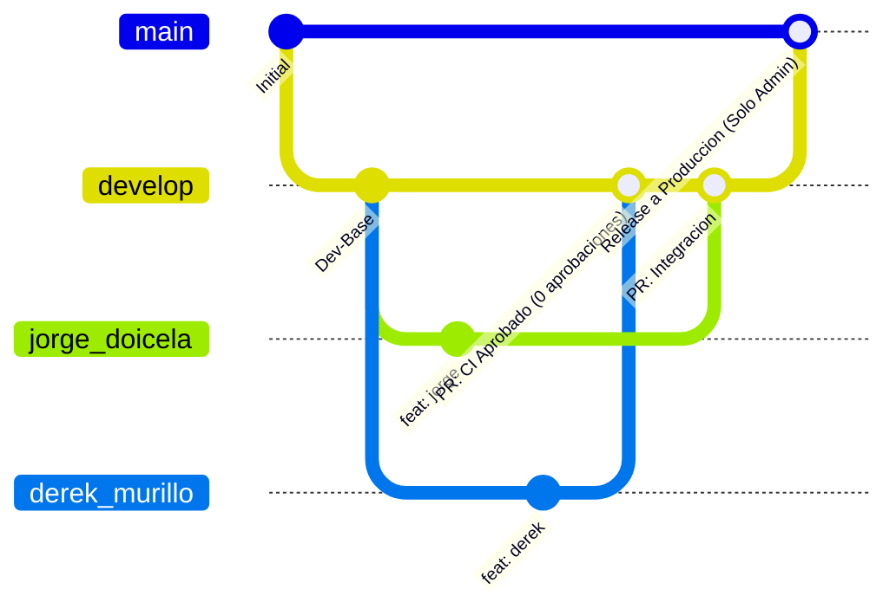
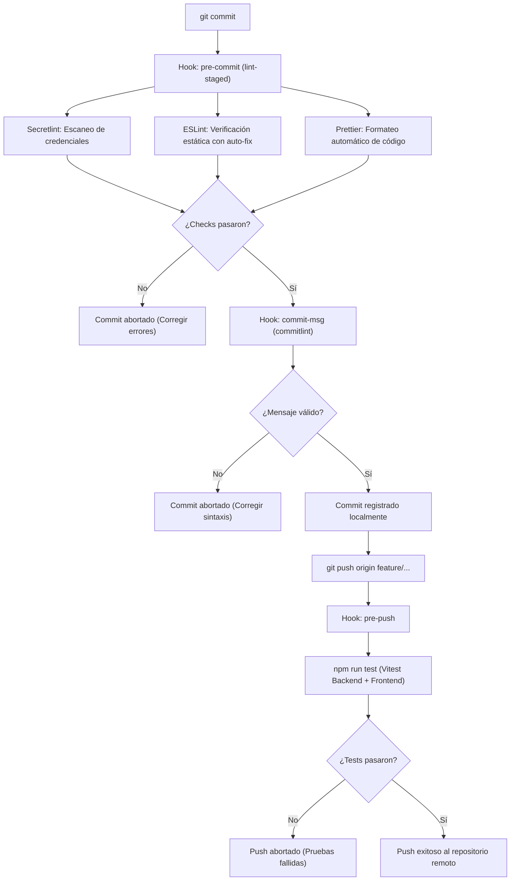
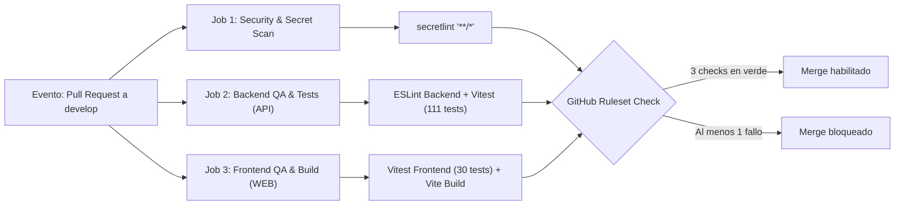
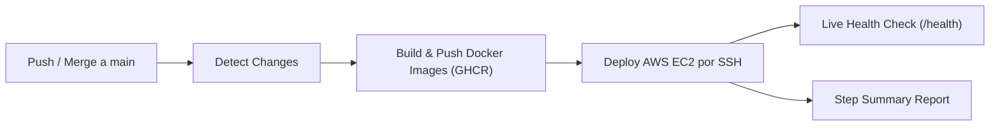

# Estándar de Flujo Git, Política de Ramas y Calidad de Código

Este documento establece las políticas de gobernanza de código, ciclo de vida de ramas en Git, hooks locales automatizados y requisitos de integración continua (CI) para el repositorio de Norma ERP. Rige de manera vinculante para todos los desarrolladores y contribuidores del proyecto.

---

## 1. Topología de Ramas y Políticas de Protección

El repositorio opera bajo un modelo adaptado de GitFlow con protección estricta a nivel de GitHub Rulesets:



### Matriz de Acceso y Reglas por Rama

| Rama            | Propósito                                | Push Directo / Escritura                                                                                            | Política de Pull Request                                                                                 | Ruleset ID |
| :-------------- | :--------------------------------------- | :------------------------------------------------------------------------------------------------------------------ | :------------------------------------------------------------------------------------------------------- | :--------- |
| `main`          | Producción estable. Despliega a AWS EC2. | **Bloqueado (`creation`, `update`, `deletion`, `non_fast_forward`):** Exclusivo para `JorgeDoicela` (bypass Admin). | Ningún colaborador sin bypass puede fusionar a `main`. Exige `1` aprobación y los 3 status checks de CI. | `26961019` |
| `develop`       | Rama de integración continua y staging.  | **Bloqueado (`pull_request`, `deletion`, `non_fast_forward`):** Bypass exclusivo para rol Admin (`JorgeDoicela`).   | **Obligatorio:** `0` aprobaciones requeridas; el merge se habilita al pasar los 3 status checks de CI.   | `26961066` |
| `jorge_doicela` | Rama activa de trabajo del titular.      | Permitido para su autor.                                                                                            | Base para enviar PR hacia `develop`.                                                                     | No aplica  |
| `derek_murillo` | Rama de trabajo de Derek Murillo.        | Permitido para su autor.                                                                                            | Base para enviar PR hacia `develop` (sin acceso de escritura ni merge sobre `main`).                     | No aplica  |
| `feature/*`     | Nuevas funcionalidades o módulos.        | Permitido para su autor.                                                                                            | Se integra exclusivamente hacia `develop` vía PR.                                                        | No aplica  |
| `fix/*`         | Corrección de defectos reportados.       | Permitido para su autor.                                                                                            | Se integra hacia `develop` vía PR.                                                                       | No aplica  |

### Restricciones Globales en Ramas Protegidas (`main` y `develop`)

1. **Prohibido el Force Push (`non_fast_forward`):** Ningún desarrollador puede sobrescribir el historial con `git push --force`.
2. **Prohibido el Borrado de Rama (`deletion`):** Las ramas `main` y `develop` están protegidas contra eliminación accidental o deliberada.
3. **Requisito de Sincronización Estricta (`strict`):** Antes de fusionar un Pull Request, la rama de origen debe estar actualizada con el último commit de la rama destino.
4. **Segregación de Roles y Bypass Exclusivo (`actor_id: 5`):** Únicamente el rol **Admin** (`JorgeDoicela`) cuenta con `bypass_mode: always`. Todo colaborador debe incorporarse con rol **Write** (nunca **Admin**) para garantizar que no pueda eludir los Pull Requests en `develop` ni actualizar `main`.

---

## 2. Guía Operativa para Desarrolladores (Paso a Paso)

Todo colaborador que se integre al proyecto debe seguir estrictamente este flujo de trabajo:

### Paso 1: Clonar y Preparar el Entorno Local

```bash
git clone https://github.com/JorgeDoicela/erp_pymes.git
cd erp_pymes
npm install
```

El comando `npm install` ejecutará automáticamente el script `prepare: "husky"`, vinculando los hooks locales en el directorio `.husky/`.

### Paso 2: Crear una Rama de Trabajo desde `develop`

Nunca inicies desarrollo sobre `main` ni sobre `develop` directamente:

```bash
git checkout develop
git pull origin develop
git checkout -b feature/nombre-de-tu-modulo
```

### Paso 3: Desarrollar y Realizar Commits con Convención Estricta

Los mensajes de commit deben ceñirse obligatoriamente a la convención **Conventional Commits**. El linter de commits (`commitlint`) rechazará cualquier mensaje que no cumpla la sintaxis:

```
<tipo>: <descripción en minúsculas y modo imperativo>
```

**Tipos válidos:**

- `feat:` Nueva funcionalidad para el usuario.
- `fix:` Corrección de un fallo o error en el código.
- `refactor:` Modificación de código sin cambiar funcionalidad externa ni corregir bugs.
- `test:` Adición o corrección de pruebas unitarias o de integración.
- `docs:` Cambios exclusivos en documentación técnica o comentarios.
- `chore:` Mantenimiento de herramientas, dependencias o configuración del repositorio.
- `perf:` Mejoras de rendimiento en consultas, renderizado o algoritmos.

**Ejemplos válidos:**

```bash
git commit -m "feat: add multi-factor authentication support"
git commit -m "fix: resolve timezone offset calculation in payroll engine"
git commit -m "test: add integration tests for offboarding service"
```

**Ejemplos inválidos (serán bloqueados por el hook):**

```bash
git commit -m "cambios"
git commit -m "Fix bug"
git commit -m "subiendo avance"
```

### Paso 4: Ciclo de Vida de los Hooks Locales (Husky)

Durante el flujo de Git se disparan tres barreras de control automatizadas:



### Paso 5: Abrir Pull Request hacia `develop`

1. Publica tu rama en GitHub:
   ```bash
   git push -u origin feature/nombre-de-tu-modulo
   ```
2. En la interfaz de GitHub, abre un Pull Request seleccionando como destino la rama **`develop`** (nunca `main`).
3. Completa la descripción del PR explicando el contexto del cambio, módulos modificados y evidencias de prueba.
4. Espera la ejecución automática del pipeline de CI.

---

## 3. Pipeline de Integración Continua (GitHub Actions)

El archivo de workflow [.github/workflows/ci.yml](../../.github/workflows/ci.yml) se ejecuta automáticamente ante cada apertura o actualización de un Pull Request dirigido a `develop` o `main`, así como en pushes directos a dichas ramas.

Se componen tres fases concurrentes que deben reportar estado satisfactorio para habilitar el botón de merge:



### Detalle de Jobs de CI

1. **`Security & Secret Scan`:**
   - Analiza el repositorio completo contra patrones de claves privadas RSA, certificados, tokens JWT expuestos y cadenas de conexión no autorizadas utilizando `secretlint`.
2. **`Backend QA & Tests (API)`:**
   - Instala dependencias con `npm ci` respetando el árbol congelado en `package-lock.json`.
   - Ejecuta `npm --prefix backend run lint` bajo ESLint Flat Config.
   - Ejecuta la suite completa de 111 pruebas unitarias y de integración del backend con Vitest.
3. **`Frontend QA & Build (WEB)`:**
   - Ejecuta las 30 pruebas unitarias de componentes y servicios del frontend.
   - Ejecuta `npm --prefix frontend run build` para asegurar que el bundle de Vite compile sin errores sintácticos o módulos faltantes.

---

## 4. Pipeline de Despliegue Continuo (CD) y Rollback Automatizado

Una vez aprobado y fusionado el Pull Request en la rama **`main`**, se activa automáticamente el pipeline de Continuous Deployment ([.github/workflows/deploy.yml](../../.github/workflows/deploy.yml)):



### Protocolo de Automatización del Despliegue:

1. **Compilación de Contenedores:** Las imágenes de `rh-backend`, `rh-frontend` y `rh-gateway` se compilan usando Docker Buildx en los runners de GitHub y se suben a GitHub Packages (`ghcr.io`).
2. **Despliegue Remoto:** El action `appleboy/ssh-action` conecta por SSH con la instancia EC2 (`${{ secrets.EC2_HOST }}`), transfiere el `docker-compose.yml` actualizado y ejecuta `docker compose pull && docker compose up -d`.
3. **Migraciones Automáticas:** El backend ejecuta `prisma migrate deploy` en su arranque antes de habilitar el servicio.
4. **Verificación de Salud:** Se ejecuta un healthcheck HTTP final confirmando la disponibilidad del sistema en `https://norma.doicela.dev`.

### Rollback Instantáneo ([.github/workflows/rollback.yml](../../.github/workflows/rollback.yml)):

En caso de fallo crítico en producción, el equipo no requiere revertir código ni reconstruir imágenes:

- Se ejecuta el workflow `Rollback - Instant AWS EC2 Deployment` indicando el SHA previo.
- El servidor descarga la versión solicitada desde GHCR y reemplaza los contenedores en caliente en menos de 60 segundos.

---

## 5. Normalización Multiplataforma y Saltos de Línea (.gitattributes)

Para prevenir fallos en entornos mixtos (desarrolladores en Windows y entornos de ejecución en Linux/Docker), el archivo [.gitattributes](../../.gitattributes) fuerza saltos de línea estrictamente en formato **LF (`\n`)** para:

- Scripts ejecutables (`*.sh`).
- Hooks del directorio `.husky/`.
- Archivos fuente JavaScript, JSX, JSON y Markdown.

Queda estrictamente prohibido alterar la configuración de `.gitattributes` o comitear scripts con terminaciones de línea Windows CRLF (`\r\n`).

---

## 6. Matriz de Comandos de Calidad Local

| Comando                 | Acción técnica                                                                 | Cuándo ejecutarlo                                        |
| :---------------------- | :----------------------------------------------------------------------------- | :------------------------------------------------------- |
| `npm run lint`          | Ejecuta ESLint secuencialmente en `frontend` y `backend`.                      | Antes de abrir un Pull Request o al finalizar cambios.   |
| `npm run format`        | Aplica Prettier con auto-escritura en todo el repositorio.                     | Para formatear archivos antes de hacer commit.           |
| `npm run format:check`  | Verifica consistencia de formato sin alterar archivos.                         | Ejecutado automáticamente en auditorías de CI.           |
| `npm run scan:secrets`  | Escanea todo el repositorio con Secretlint en busca de credenciales expuestas. | En auditorías de seguridad y en pipeline de CI.          |
| `npm run test`          | Ejecuta la suite de Vitest de backend y frontend en secuencia.                 | Automatizado en hook `pre-push`.                         |
| `npm run test:backend`  | Ejecuta exclusivamente las pruebas de la API (111 tests).                      | Durante desarrollo de servicios o controladores backend. |
| `npm run test:frontend` | Ejecuta exclusivamente las pruebas de interfaz (30 tests).                     | Durante desarrollo de componentes React.                 |
