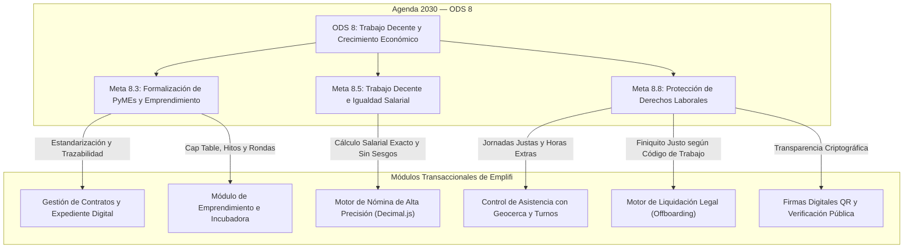

# Alineación Estratégica con el ODS 8 — Trabajo Decente y Crecimiento Económico

Este documento formaliza la vinculación exclusiva y directa de la plataforma **Emplifi (ERP PYMES)** con el **Objetivo de Desarrollo Sostenible 8 de la Organización de las Naciones Unidas (ONU): Promover el crecimiento económico inclusivo y sostenible, el empleo y el trabajo decente para todos**.

---

## 1. Justificación y Problemática Estructural

En América Latina y el Ecuador, las Pequeñas y Medianas Empresas (PyMEs) generan la mayor parte del empleo privado, pero enfrentan barreras críticas para garantizar condiciones laborales estandarizadas y sostenibles:

1. **Informalidad Contractual y Desprotección:** Alta rotación no registrada, contratos verbales o en formatos estáticos sin control de vencimientos, exponiendo al trabajador a la incertidumbre y a la empresa a contingencias laborales.
2. **Precarización en la Remuneración:** Errores sistemáticos en el cálculo manual de horas suplementarias, recargos nocturnos, fondos de reserva y décimos, generando desconfianza y disputas laborales.
3. **Evasión o Retraso en Seguridad Social:** Dificultad para conciliar y declarar oportunamente las aportaciones patronales y personales ante el Instituto Ecuatoriano de Seguridad Social (IESS).
4. **Vulnerabilidad en Procesos de Desvinculación:** Liquidaciones arbitrarias, falta de transparencia en causales de despido o desahucio y liquidación inexacta de haberes pendientes.

Emplifi aborda este problema estructurando un sistema de gestión empresarial y de recursos humanos que convierte la normativa laboral ecuatoriana en reglas de negocio programáticas, deterministas y auditables, garantizando el trabajo formal y digno en la pequeña y mediana empresa.

---

## 2. Metas Específicas de la ONU y Cobertura Funcional

---

## 3. Matriz de Trazabilidad Cruzada

| Meta de la ONU                               | Requerimiento Operativo                                                         | Componente Técnico en Emplifi                                               | Impacto Demostrable                                                                                      |
| :------------------------------------------- | :------------------------------------------------------------------------------ | :-------------------------------------------------------------------------- | :------------------------------------------------------------------------------------------------------- |
| **8.3 (Formalización y Crecimiento PyME)**   | Sustituir la informalidad laboral mediante contratos formalizados y auditables. | `contract.service.js`, `contractCronJob.js`                                 | 100% de colaboradores con contrato tipificado, expediente digital y alerta automática de vencimientos.   |
| **8.3 (Emprendimiento e Innovación)**        | Apoyar la maduración y escalabilidad de nuevas empresas emergentes.             | `entrepreneurship.service.js`                                               | Registro de rondas de inversión, tablas de capitalización y seguimiento de hitos de crecimiento.         |
| **8.5 (Salario Justo y No Discriminación)**  | Liquidar sueldos y aportes sin deducciones indebidas ni errores de redondeo.    | `payrollCalculationService.js`, `financialUtils.js`                         | Liquidación con 20 dígitos de precisión decimal (`ROUND_HALF_UP`), garantizando remuneraciones íntegras. |
| **8.5 (Seguridad Social)**                   | Garantizar la afiliación obligatoria y aportación exacta al IESS.               | `payrollCalculationService.js` (retención personal 9.45% / patronal 11.15%) | Generación de comprobantes desglosados y conciliables con las planillas del IESS.                        |
| **8.8 (Jornada Justa y Derechos Laborales)** | Proteger la jornada laboral legal y retribuir el trabajo extraordinario.        | `attendanceService.js`, geofencing, WebAuthn                                | Reconocimiento automático de horas suplementarias (25%, 50%) y extraordinarias (100%).                   |
| **8.8 (Desvinculación Legal)**               | Eliminar despidos intempestivos sin indemnización reglamentaria.                | `offboardingService.js`                                                     | Cálculo de actas de finiquito ajustadas estrictamente al Código del Trabajo (Arts. 185, 188).            |
