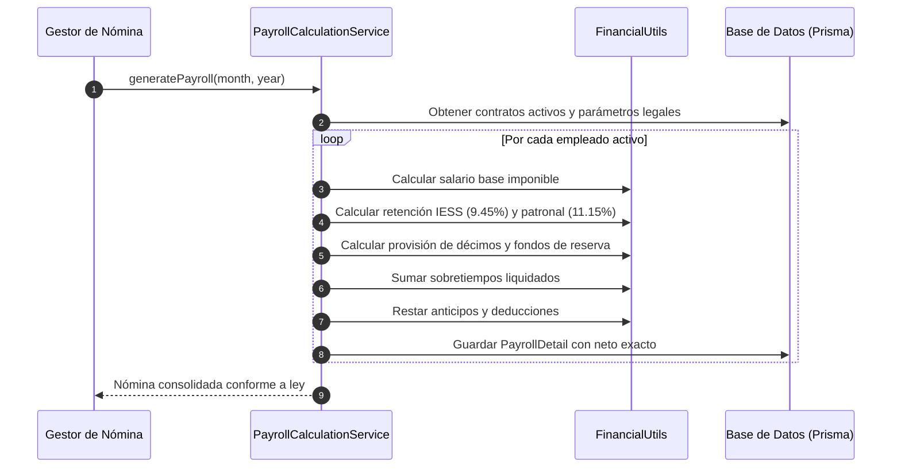

# Metas y Mecanismos de Implementación — ODS 8

Este documento detalla los mecanismos técnicos, reglas de negocio e implementaciones en el código fuente de **Norma ERP** para el cumplimiento de las metas del **ODS 8 (Trabajo Decente y Crecimiento Económico)**.

---

## 1. Mecanismos para la Meta 8.3: Formalización y Crecimiento de PyMEs

### 1.1. Estandarización del Expediente y Contratación Laboral

- **Ruta en Código:** `backend/src/services/employees/contract.service.js`
- **Lógica Operativa:**
  - Toda vinculación laboral requiere el registro de un tipo contractual tipificado en la legislación ecuatoriana (Indefinido, Eventual, Ocasional, Por Temporada, Obra Cierta, Aprendizaje).
  - Monitoreo automatizado con `contractCronJob.js` que audita contratos próximos a vencer a 30, 15 y 5 días, notificando al departamento de RRHH para su renovación formal o terminación en plazos legales, erradicando contratos en el limbo jurídico.
  - Expediente digital único con almacenamiento de identificaciones, títulos, certificaciones y comprobantes de afiliación al IESS.

### 1.2. Módulo de Incubación y Formalización de Emprendimientos

- **Ruta en Código:** `backend/src/services/entrepreneurship/entrepreneurship.service.js`
- **Lógica Operativa:**
  - Brinda a los fundadores de PyMEs y microempresas un marco estructurado para gestionar su capital social (`EntrepreneurshipEquity`), rondas de inversión (`EntrepreneurshipFundingRound`) y metas operativas (`EntrepreneurshipMilestone`).
  - Facilita la transición de emprendimientos informales a empresas formalmente constituidas con estructura organizativa, métricas de gobernanza y roles de personal claros.

---

## 2. Mecanismos para la Meta 8.5: Trabajo Decente, Salario Justo e Igualdad

### 2.1. Aritmética Financiera de Alta Precisión

- **Ruta en Código:** `backend/src/utils/financialUtils.js`
- **Fundamento:** El estándar binario IEEE 754 de punto flotante en JavaScript introduce errores acumulativos de redondeo (ej. `0.1 + 0.2 !== 0.3`). En software de nómina, esto provoca pérdidas monetarias que menoscaban el salario del trabajador.
- **Solución Técnica:** Norma ERP configura `Decimal.js` con precisión de 20 dígitos y estrategia de redondeo simétrico a la mitad hacia arriba (`Decimal.ROUND_HALF_UP`):
  ```javascript
  import { Decimal } from 'decimal.js';
  Decimal.set({ precision: 20, rounding: Decimal.ROUND_HALF_UP });
  ```

### 2.2. Liquidación Automatizada de Beneficios Sociales de Ley

- **Ruta en Código:** `backend/src/services/payroll/payrollCalculationService.js`
- **Reglas Aplicadas:**
  1. **Décimo Tercer Sueldo (Bono Navideño):** Cálculo equivalente a la doceava parte de todas las remuneraciones percibidas durante el año calendario (1 de diciembre a 30 de noviembre). Opción de pago mensualizado o acumulado.
  2. **Décimo Cuarto Sueldo (Bono Escolar):** Provisión de una doceava parte del Salario Básico Unificado (SBU) vigente en el régimen correspondiente (Sierra o Costa).
  3. **Fondos de Reserva:** 8.33% de la remuneración mensual percibida a partir del segundo año de servicio continuo (mes 13 en adelante).
  4. **Seguridad Social (IESS):** Retención obligatoria del 9.45% sobre la materia gravada para el aporte del trabajador, más el 11.15% correspondiente al aporte patronal.



---

## 3. Mecanismos para la Meta 8.8: Protección de Derechos Laborales y Finiquitos

### 3.1. Control Fidedigno de Jornadas y Horas Extras

- **Ruta en Código:** `backend/src/services/attendance/attendanceService.js`
- **Lógica Operativa:**
  - Marcación biométrica mediante estándares abiertos FIDO2 / WebAuthn, garantizando que el registro de asistencia sea personal e infalsificable.
  - Geocercas geográficas que validan que la jornada se desempeñe en los puntos de trabajo autorizados.
  - Clasificación legal estricta del tiempo trabajado:
    - **Jornada Ordinaria:** 8 horas diarias / 40 horas semanales.
    - **Horas Suplementarias:** Realizadas a continuación de la jornada diurna (recargo del 25% o 50% según horario).
    - **Horas Extraordinarias:** Realizadas en sábados, domingos o feriados de descanso obligatorio (recargo del 100%).
    - **Recargo Nocturno:** Incremento del 25% en horas trabajadas entre las 19:00 y las 06:00.

### 3.2. Motor de Desvinculación Justa (Offboarding Legal)

- **Ruta en Código:** `backend/src/services/employees/offboardingService.js`
- **Lógica Operativa:**
  - Elimina la fijación arbitraria de finiquitos aplicando directamente las fórmulas del Código del Trabajo:
    - **Desahucio (Art. 185):** Bonificación del 25% de la última remuneración mensual por cada año completo de servicio.
    - **Despido Intempestivo (Art. 188):** Indemnización escalonada por años de servicio (hasta 3 años: 3 meses de sueldo; más de 3 años: 1 mes de sueldo por cada año adicional hasta un tope de 25 meses).
    - **Vacaciones No Gozadas:** Liquidación monetaria proporcional de los días no disfrutados.
    - **Proporcionales de Décimos:** Doceavas partes devengadas a la fecha de corte.
  - Emisión del acta de finiquito con firma digital criptográfica SHA-256 y código QR para verificación pública inmediata.
