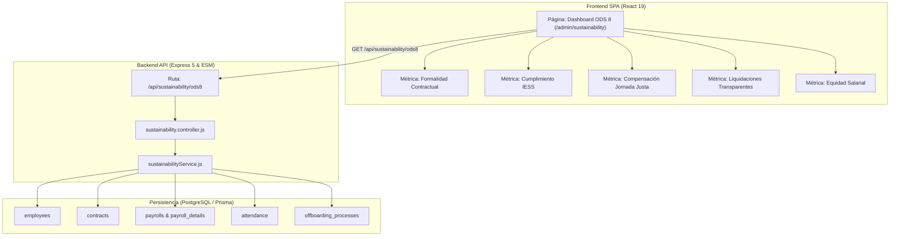

# Especificación Técnica de Refactorización — Métricas y Dashboard ODS 8

Este documento define la arquitectura de software, los contratos de API REST, la lógica del servicio de agregación y los requerimientos de interfaz para implementar formalmente el **Módulo de Métricas y Gobernanza del ODS 8 (Trabajo Decente y Crecimiento Económico)** en la plataforma **Emplifi**.

---

## 1. Arquitectura General del Módulo



---

## 2. Contrato de API REST

### Endpoint de Métricas ODS 8

- **Método:** `GET`
- **Ruta:** `/api/sustainability/ods8`
- **Autenticación:** Requerida (`Bearer Token`)
- **Middlewares:** `authenticate`, `requireTenant`
- **Roles Autorizados:** `admin`, `hr`, `superadmin`

#### Respuesta JSON (`200 OK`):

```json
{
  "success": true,
  "data": {
    "tenantId": "cuid_tenant_123",
    "calculatedAt": "2026-11-10T16:00:00.000Z",
    "ods": {
      "code": 8,
      "name": "Trabajo Decente y Crecimiento Económico",
      "overallScore": 97.4,
      "complianceLevel": "ALTO",
      "indicators": {
        "formalContractRate": {
          "code": "8.3.1",
          "label": "Tasa de Formalidad Contractual",
          "value": 100.0,
          "target": 100.0,
          "unit": "%",
          "status": "COMPLIANT",
          "summary": "52 de 52 colaboradores activos disponen de contrato formal registrado y vigente."
        },
        "socialSecurityCoverage": {
          "code": "8.5.1",
          "label": "Cumplimiento de Aportaciones al IESS",
          "value": 100.0,
          "target": 100.0,
          "unit": "%",
          "status": "COMPLIANT",
          "summary": "100% de nóminas emitidas con retención personal (9.45%) y patronal (11.15%) calculadas."
        },
        "overtimeCompensationRatio": {
          "code": "8.8.1",
          "label": "Compensación de Jornada Extraordinaria",
          "value": 1.0,
          "target": 1.0,
          "unit": "ratio",
          "status": "COMPLIANT",
          "summary": "Todas las horas extras registradas mediante geocerca fueron liquidadas en nómina."
        },
        "verifiedLegalSettlements": {
          "code": "8.8.2",
          "label": "Transparencia en Finiquitos Laborales",
          "value": 100.0,
          "target": 100.0,
          "unit": "%",
          "status": "COMPLIANT",
          "summary": "El 100% de las desvinculaciones cuenta con acta de finiquito y verificación criptográfica QR."
        },
        "salaryEquitablityIndex": {
          "code": "8.5.2",
          "label": "Cumplimiento de Salario Básico y Dignidad",
          "value": 100.0,
          "target": 100.0,
          "unit": "%",
          "status": "COMPLIANT",
          "summary": "0 contratos por debajo del Salario Básico Unificado vigente."
        }
      }
    }
  }
}
```

---

## 3. Lógica del Servicio (`sustainabilityService.js`)

El servicio agrega información a partir de las entidades del esquema relacional:

1. **Formalidad Contractual (`formalContractRate`):**

   ```javascript
   const totalEmployees = await prisma.employee.count({ where: { isActive: true } });
   const employeesWithActiveContract = await prisma.employee.count({
     where: {
       isActive: true,
       contracts: { some: { status: 'Active' } },
     },
   });
   const formalContractRate =
     totalEmployees > 0 ? (employeesWithActiveContract / totalEmployees) * 100 : 100;
   ```

2. **Aportaciones al IESS (`socialSecurityCoverage`):**
   Valida que los registros de `PayrollDetail` del último período contengan los conceptos gravados de seguridad social:

   ```javascript
   // Verificación de existencia de deducción 9.45% y patronal 11.15%
   ```

3. **Compensación de Horas Extraordinarias (`overtimeCompensationRatio`):**
   Suma las horas en `Attendance.overtimeHours` del mes y las contrasta con las horas liquidadas en los conceptos de sobretiempo en `PayrollDetail`.

4. **Transparencia en Desvinculaciones (`verifiedLegalSettlements`):**
   Verifica que los procesos de `OffboardingProcess` cuenten con liquidación calculada y documento firmado digitalmente.

---

## 4. Requerimientos de Interfaz de Usuario (Frontend)

Siguiendo estrictamente las reglas de diseño del proyecto (**Holded / Linear**):

- **Ruta:** `/admin/sustainability`
- **Estructura Visual:**
  - Fondo: `#f9fafb`.
  - Encabezado: Título sobrio _"Sostenibilidad y Gobernanza Laboral (ODS 8)"_ con selector de período.
  - Tarjetas de Indicador: Fondo blanco `#ffffff`, borde fino `1px solid #e5e7eb`, esquinas `rounded-[4px]`.
  - Cero emojis, cero gradientes y cero sombras decorativas en tablas.
  - Valores numéricos, porcentajes y fechas representados estrictamente con tipografía `font-mono tabular-nums`.
  - Indicadores de estado mediante etiquetas de texto sobrias (`CONFORME`, `OBSERVADO`).
