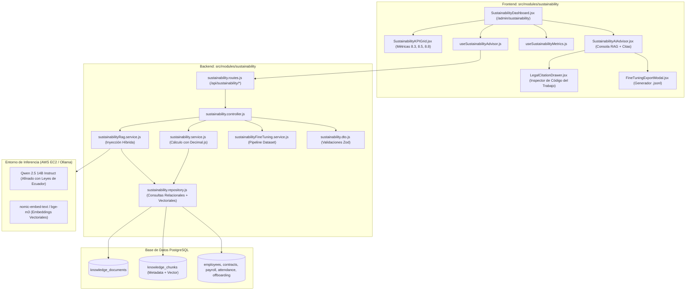

# Arquitectura del Asistente de IA: RAG con Legislación Ecuatoriana y Fine-Tuning para ODS 8

Este documento técnico consolida la arquitectura, el estado de implementación, el corpus normativo y la guía de continuidad operativa para el **Asistente de Inteligencia Artificial y Gobernanza del ODS 8 (Trabajo Decente y Crecimiento Económico)** en la plataforma **Norma ERP**.

---

## 1. Visión General y Bounded Context

El módulo está estructurado bajo la **Arquitectura Modular por Dominio (Bounded Context / Monolito Modular)** en backend y frontend. Resuelve dos desafíos esenciales en software empresarial:

1. **Cero Alucinaciones Legales:** Empleo de RAG (Retrieval-Augmented Generation) sobre la base vectorial en PostgreSQL (`pgvector`), extrayendo artículos textuales del Código del Trabajo de Ecuador antes de responder.
2. **Especialización y Razonamiento Jurídico-Laboral:** Fine-Tuning de un modelo abierto grande (**Qwen 2.5 14B Instruct**) entrenado en Google Colab (GPU NVIDIA A100) y desplegado en Amazon Web Services (AWS) optimizando costos para operar durante 1 semana continua con un presupuesto de $100 USD.



---

## 2. Componentes Implementados en el Repositorio

### 2.1 Backend (`backend/src/modules/sustainability/`)

| Archivo                               | Responsabilidad Técnica                                                                                            |
| :------------------------------------ | :----------------------------------------------------------------------------------------------------------------- |
| `sustainability.dto.js`               | Validación Zod para consultas RAG, ingestión de documentos y opciones de exportación JSONL.                        |
| `sustainability.repository.js`        | Consultas agregadas multi-tabla en PostgreSQL y matching semántico de artículos normativos.                        |
| `sustainability.service.js`           | Cálculo con `Decimal.js` (20 dígitos `ROUND_HALF_UP`) de los 5 KPIs del ODS 8 (8.3.1, 8.5.1, 8.5.2, 8.8.1, 8.8.2). |
| `sustainabilityRag.service.js`        | Orquestador RAG que vincula fragmentos normativos ecuatorianos con las métricas en tiempo real de la empresa.      |
| `sustainabilityFineTuning.service.js` | Ensamblador de pares de instrucción y respuesta en formato Alpaca/Unsloth (Llama/Qwen) y OpenAI JSONL.             |
| `sustainability.controller.js`        | Controladores HTTP para `/ods8`, `/advisor/query`, `/knowledge/ingest` y `/fine-tuning/export`.                    |
| `sustainability.routes.js`            | Enrutador protegido por autenticación (`authenticate`) y aislamiento de tenant (`requireTenant`).                  |
| `index.js`                            | Barrel export público del módulo.                                                                                  |

### 2.2 Base de Datos (`backend/prisma/`)

- **Esquema (`schema.prisma`):** Modelos `KnowledgeDocument` y `KnowledgeChunk` asociados a `Tenant` con índices para `category` y `odsTarget`.
- **Migración SQL:** `prisma/migrations/20261110162000_add_sustainability_rag_knowledge/migration.sql`.
- **Seed Automatizado:** `prisma/seeds/sustainability.js` integrado en `prisma/seed.js`.

### 2.3 Frontend (`frontend/src/modules/sustainability/`)

| Archivo                       | Responsabilidad en la UI (Estándar Holded/Linear)                                             |
| :---------------------------- | :-------------------------------------------------------------------------------------------- |
| `SustainabilityDashboard.jsx` | Tablero ejecutivo en `/admin/sustainability` con porcentaje de cumplimiento global.           |
| `SustainabilityKPIGrid.jsx`   | Grilla de tarjetas de indicadores con estados `CONFORME` y `ATENCIÓN`.                        |
| `SustainabilityKPICard.jsx`   | Tarjeta individual con valores monoespaciados (`font-mono`, `tabular-nums`) y meta.           |
| `SustainabilityAIAdvisor.jsx` | Consola conversacional con presets legales, historial de diálogo y badges de citación.        |
| `LegalCitationDrawer.jsx`     | Panel lateral para lectura del artículo oficial del Código del Trabajo o resolución del IESS. |
| `FineTuningExportModal.jsx`   | Modal interactivo para seleccionar la arquitectura LLM y descargar el `.jsonl`.               |
| `sustainability.service.js`   | Cliente HTTP que consume los endpoints `/api/sustainability/*`.                               |
| `useSustainabilityMetrics.js` | Hook para ciclo de vida y recálculo de métricas ODS 8.                                        |
| `useSustainabilityAdvisor.js` | Hook de interacción conversacional del asistente.                                             |

---

## 3. Corpus Normativo Oficial en el Repositorio

Los documentos fuente están alojados en `docs/09-sostenibilidad-ods/corpus-legal/` y versionados con Git:

| Documento                    | Archivo en Repositorio                        | Tamaño  | Aspectos Normativos Extraídos                                                                                                                                                                        |
| :--------------------------- | :-------------------------------------------- | :------ | :--------------------------------------------------------------------------------------------------------------------------------------------------------------------------------------------------- |
| **Constitución del Ecuador** | `01-constitucion-republica-ecuador-2008.pdf`  | 370 KB  | Arts. 33, 325-329: Principio de no precarización, afiliación obligatoria a seguridad social, igualdad remunerativa.                                                                                  |
| **Código del Trabajo**       | `02-codigo-del-trabajo-ecuador.pdf`           | 419 KB  | Arts. 11-19 (Contratos y prueba de 90 días), Art. 47 (Jornada 40h), Art. 55 (Horas suplementarias 50% y extraordinarias 100%), Art. 185 (Desahucio 25%), Art. 188 (Despido intempestivo escalonado). |
| **Ley de Seguridad Social**  | `03-ley-de-seguridad-social-iess.pdf`         | 618 KB  | Ley 2001-55: Seguro General Obligatorio, aportaciones (9.45% personal / 11.15% patronal), fondos de reserva (8.33% mes 13).                                                                          |
| **Metodología ODS 8 (OIT)**  | `04-oit-metodologia-ods8-trabajo-decente.pdf` | 2.17 MB | Informe técnico de las metas 8.3, 8.5 y 8.8 de la Agenda 2030 para trabajo decente y erradicación de informalidad.                                                                                   |

---

## 4. Estrategia de Entrenamiento (Google Colab con GPU A100)

### 4.1 Selección del Modelo: Qwen 2.5 14B Instruct

- **Justificación:** Capacidades superiores en razonamiento contable/laboral en español, formato de salida JSON y ventana de contexto de hasta 128k tokens.
- **Rendimiento en A100:** Tiempo estimado de entrenamiento con LoRA / QLoRA mediante **Unsloth**: 45 a 70 minutos.

### 4.2 Script de Entrenamiento para Colab (`train_qwen_unsloth.py`)

```python
# Script base para ejecutar en Google Colab con entorno GPU A100
from unsloth import FastLanguageModel
import torch

max_seq_length = 4096
dtype = None # Auto detección
load_in_4bit = True # QLoRA de alta eficiencia

# 1. Cargar modelo base
model, tokenizer = FastLanguageModel.from_pretrained(
    model_name="Qwen/Qwen2.5-14B-Instruct",
    max_seq_length=max_seq_length,
    dtype=dtype,
    load_in_4bit=load_in_4bit,
)

# 2. Configurar adaptadores LoRA
model = FastLanguageModel.get_peft_model(
    model,
    r=16,
    target_modules=["q_proj", "k_proj", "v_proj", "o_proj", "gate_proj", "up_proj", "down_proj"],
    lora_alpha=16,
    lora_dropout=0,
    bias="none",
    use_gradient_checkpointing="unsloth",
    random_state=3407,
)

# 3. Cargar dataset generado por Norma ERP
from datasets import load_dataset
dataset = load_dataset("json", data_files="fine_tuning_ecuador_ods8_llama3.jsonl")

# 4. Entrenar y exportar a formato GGUF / Ollama
from trl import SFTTrainer
from transformers import TrainingArguments

trainer = SFTTrainer(
    model=model,
    tokenizer=tokenizer,
    train_dataset=dataset["train"],
    dataset_text_field="output",
    max_seq_length=max_seq_length,
    args=TrainingArguments(
        per_device_train_batch_size=4,
        gradient_accumulation_steps=4,
        warmup_steps=10,
        max_steps=120,
        learning_rate=2e-4,
        fp16=not torch.cuda.is_bf16_supported(),
        bf16=torch.cuda.is_bf16_supported(),
        logging_steps=5,
        output_dir="outputs",
    ),
)
trainer.train()

# Guardar en GGUF para Ollama/vLLM
model.save_pretrained_gguf("qwen2.5-14b-ecuador-ods8", tokenizer, quantization_method="q4_k_m")
```

---

## 5. Estrategia de Despliegue en AWS (1 Semana / Presupuesto de $100 USD)

Para mantener el sistema operativo durante 7 días (168 horas continuas) sin exceder los $100 USD de crédito:

### Opción Recomendada: Instancia Spot con GPU (`g5.xlarge`)

- **Tipo de Instancia:** `g5.xlarge` (NVIDIA A10G 24GB VRAM, 4 vCPUs, 16GB RAM).
- **Modalidad:** EC2 Spot Instance en región `us-east-1` o `us-west-2`.
- **Costo por Hora:** ~$0.35 - $0.40 USD.
- **Costo Total (168 horas):** ~$59 a $67 USD (quedan ~$33 USD de margen).
- **Rendimiento:** Inferencia en streaming con GPU a ~60 tokens/segundo.

### Despliegue en el Servidor AWS:

```bash
# 1. Instalar Ollama en la instancia EC2
curl -fsSL https://ollama.com/install.sh | sh

# 2. Descargar modelo de embeddings para la base vectorial
ollama pull nomic-embed-text

# 3. Crear el modelo especializado a partir del archivo GGUF entrenado en Colab
cat <<EOF > Modelfile
FROM ./qwen2.5-14b-ecuador-ods8-q4_k_m.gguf
PARAMETER temperature 0.2
PARAMETER stop "<|im_end|>"
SYSTEM "Eres el Asistente Experto en Cumplimiento Laboral de Ecuador y Gobernanza ODS 8 en Norma ERP."
EOF

ollama create ecuador-erp-ai -f Modelfile

# 4. Iniciar servicio en puerto público/privado
OLLAMA_HOST=0.0.0.0:11434 ollama serve
```

### Configuración en Norma ERP (`backend/.env`):

```env
AI_LLM_URL=http://<IP_PUBLICA_O_DNS_AWS>:11434
AI_LLM_MODEL=ecuador-erp-ai
AI_EMBEDDING_MODEL=nomic-embed-text
```

---

## 6. Guía de Continuidad en Otra Máquina

Al clonar o mover este repositorio a otro entorno de desarrollo:

1. **Clonar e instalar dependencias:**
   ```bash
   git clone <url-repositorio>
   cd erp_pymes
   cd backend && npm install
   cd ../frontend && npm install
   ```
2. **Generar cliente de base de datos:**
   ```bash
   cd backend
   npx prisma generate
   ```
3. **Verificar corpus legal:**
   Los archivos PDF ya se encuentran disponibles en:
   `docs/09-sostenibilidad-ods/corpus-legal/`
4. **Ejecutar seed normativo:**
   ```bash
   node src/modules/sustainability/data/seedSustainability.js
   ```
5. **Iniciar desarrollo:**
   - Backend: `npm run dev` en `backend/`
   - Frontend: `npm run dev` en `frontend/`
   - Acceso: `http://localhost:5173/admin/sustainability`
