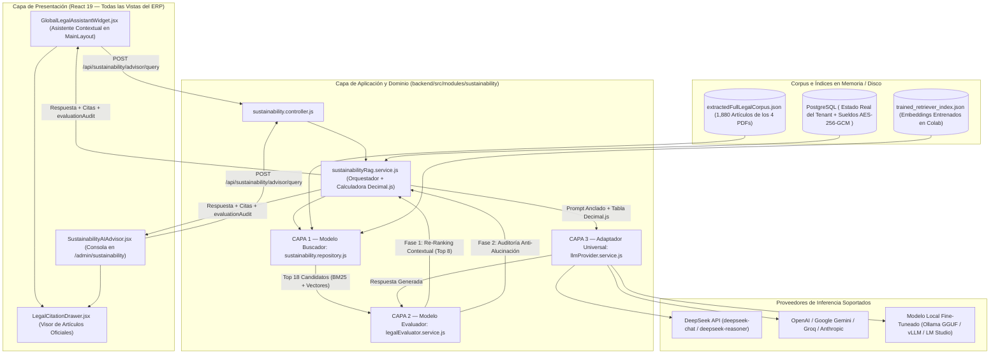
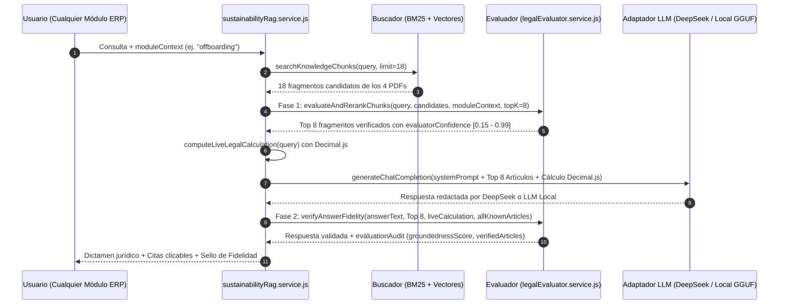

# Arquitectura del Asistente de IA Multi-Módulo: Buscador Semántico (1,880 Artículos), Evaluador Anti-Alucinación, Adaptador DeepSeek / Multi-LLM y Fine-Tuning en Google Colab

Este documento especifica la arquitectura de software, los algoritmos de recuperación y verificación normativa, los contratos de API REST, los componentes de interfaz transversal y el pipeline de entrenamiento en Google Colab del **Asistente Jurídico, Laboral, Contable y de Sostenibilidad ODS 8** integrado en **Norma ERP**.

---

## 1. Extracción Íntegra (100%) de los 4 Cuerpos Normativos Oficiales

> [!IMPORTANT]
> El sistema opera exclusivamente sobre el texto oficial extraído de las 540 páginas de los 4 documentos normativos almacenados en `docs/09-sostenibilidad-ods/corpus-legal/`. No se utilizan resúmenes manuales que sustituyan o recorten el articulado original.

El script [`extractAllFourPdfs.js`](../../backend/src/modules/sustainability/data/extractAllFourPdfs.js) procesa los 4 archivos PDF mediante `pdfjs-dist`, reconstruye los saltos de línea respetando la estructura tipográfica de cada cuerpo legal y segmenta la totalidad del texto en artículos individuales, disposiciones generales, disposiciones transitorias y secciones metodológicas dentro de [`extractedFullLegalCorpus.json`](../../backend/src/modules/sustainability/data/extractedFullLegalCorpus.json).

### 1.1. Inventario Exacto del Corpus Extraído e Indexado

| ID Documento           | Archivo Fuente (`corpus-legal/`)              | Categoría en Sistema        | Páginas Procesadas | Artículos / Secciones Extraídas |   Caracteres Extraídos   |  Meta ODS Principal   |
| :--------------------- | :-------------------------------------------- | :-------------------------- | :----------------: | :-----------------------------: | :----------------------: | :-------------------: |
| `constitucion_2008`    | `01-constitucion-republica-ecuador-2008.pdf`  | `CONSTITUTION`              |        136         |          481 artículos          |         400,261          |     `8.5` / `8.8`     |
| `codigo_trabajo`       | `02-codigo-del-trabajo-ecuador.pdf`           | `LABOR_CODE`                |        157         |          714 artículos          |         587,255          | `8.3` / `8.5` / `8.8` |
| `ley_seguridad_social` | `03-ley-de-seguridad-social-iess.pdf`         | `IESS_REGULATION`           |        104         |          383 artículos          |         357,385          |         `8.5`         |
| `oit_metodologia_ods8` | `04-oit-metodologia-ods8-trabajo-decente.pdf` | `ODS_8_FRAMEWORK`           |        143         |          302 secciones          |         398,353          | `8.3` / `8.5` / `8.8` |
| **TOTAL OFICIAL**      | **4 Documentos Oficiales**                    | **4 Categorías Normativas** |  **540 páginas**   | **1,880 artículos y secciones** | **1,743,254 caracteres** |  **ODS 8 Completo**   |

### 1.2. Reglas de Segmentación en `extractAllFourPdfs.js`

1. **Documentos Legislativos (`Constitución`, `Código del Trabajo`, `Ley de Seguridad Social`):**
   - Detección por expresión regular de cabeceras de artículo (`Art. N.-`, `Artículo N.-`, `Art. Innumerado`) y disposiciones (`DISPOSICIÓN TRANSITORIA`, `DISPOSICIÓN GENERAL`, `DISPOSICIÓN REFORMATORIA`).
   - Cuando un artículo extenso supera los `2,200` caracteres, el segmentador lo divide en sub-bloques lógicos (`Parte 1`, `Parte 2`, etc.) conservando el código del artículo original (`articleCode`) para evitar truncamiento en la ventana de contexto y mantener alta precisión en el cálculo de relevancia BM25.
2. **Documento Metodológico (`OIT Indicadores de Trabajo Decente ODS 8`):**
   - Agrupación semántica por indicadores estadísticos de la OIT y bloques de hasta `1,400` caracteres con preservación de títulos de sección y fórmulas de cálculo.

---

## 2. Arquitectura de 3 Capas: Buscador + Evaluador + Modelo Grande / Local

El motor de inteligencia artificial separa estrictamente las responsabilidades de **búsqueda documental**, **evaluación de fidelidad normativa** y **síntesis generativa**, impidiendo que el modelo de lenguaje invente artículos o altere cálculos financieros.



---

### 2.1. Capa 1 — Modelo Buscador (`sustainability.repository.js`)

El repositorio [`sustainability.repository.js`](../../backend/src/modules/sustainability/sustainability.repository.js) implementa un motor de búsqueda híbrido en memoria que indexa los 1,880 artículos al iniciar el proceso:

1. **Índice Invertido BM25 Pre-Tokenizado:**
   - Normaliza acentos y signos de puntuación, calcula la frecuencia de término $f(t, D)$ por artículo y el factor de frecuencia inversa de documento $\text{IDF}(t)$ sobre los $N = 1,880$ fragmentos:
     $$\text{IDF}(t) = \ln\left(1 + \frac{N - \text{df}(t) + 0.5}{\text{df}(t) + 0.5}\right)$$
   - Evalúa cada artículo respecto a la consulta expandida $Q$ mediante la ecuación Okapi BM25 ($k_1 = 1.5, b = 0.75$):
     $$\text{Score}_{\text{BM25}}(D, Q) = \sum_{t \in Q} \text{IDF}(t) \cdot \frac{f(t, D) \cdot (k_1 + 1)}{f(t, D) + k_1 \cdot \left(1 - b + b \cdot \frac{|D|}{\text{avgdl}}\right)}$$
2. **Detección Exacta de Artículos y Expansión Jurídica:**
   - Si el usuario menciona explícitamente un número de artículo (ej. `Art. 188`, `artículo 55`, `Art. 326`), el buscador aplica un impulso determinista de `+45.0` puntos sobre los fragmentos cuyo `articleCode` contenga dicho numeral.
   - Expande los términos de búsqueda mediante el diccionario `ECUADOR_LEGAL_SYNONYMS` (vinculando términos coloquiales como _finiquito_, _despido_, _renuncia_, _décimo_, _utilidades_ o _horas extras_ con sus números de artículo correspondientes).
3. **Fusión con Embeddings Entrenados en Google Colab (`trained_retriever_index.json`):**
   - Si existe el archivo `backend/src/modules/sustainability/data/trained_retriever_index.json` exportado desde el cuaderno de Google Colab, el repositorio carga el mapa de vectores densos normalizados y refuerza los artículos indexados.

---

### 2.2. Capa 2 — Modelo Evaluador (`legalEvaluator.service.js`)

El servicio [`legalEvaluator.service.js`](../../backend/src/modules/sustainability/legalEvaluator.service.js) actúa como filtro de precisión antes de llamar al LLM y como juez auditor después de que el LLM genera la respuesta:



#### Fase 1: Re-Ranking Cross-Encoder (`evaluateAndRerankChunks`)

Califica cada fragmento candidato en el rango $[0.15, 0.99]$ sumando cinco componentes:

- **Componente Retriever ($0.00$ a $0.45$):** Puntaje BM25 relativo al máximo candidato de la consulta.
- **Cobertura Léxica Exacta ($0.00$ a $0.25$):** Proporción de tokens de la pregunta presentes en el artículo.
- **Coincidencia de Bigramas Jurídicos ($0.00$ a $0.15$):** Pares de palabras consecutivas exactas (ej. `despido intempestivo`, `período prueba`, `aporte patronal`).
- **Bono de Artículo Exacto ($+0.25$):** Coincidencia exacta con el número de artículo solicitado.
- **Afinidad Contextual con el Módulo del ERP ($+0.10$):** Prioriza las categorías normativas asociadas a la pantalla actual del usuario (`MODULE_DOMAIN_AFFINITY`).

#### Fase 2: Juez Anti-Alucinación (`verifyAnswerFidelity`)

Una vez generada la respuesta del modelo grande, el evaluador:

1. Extrae mediante expresión regular todas las menciones a artículos (`Art. X`) en el texto generado.
2. Verifica cada artículo contra los fragmentos recuperados y contra el conjunto global `_knownArticleNumbers` extraído de los 1,880 artículos de los 4 PDFs.
3. Si hubo un cálculo matemático en vivo con `Decimal.js`, verifica que el monto total (`totalSettlement`, `totalOvertimePay` o `netSalary`) figure exactamente en la respuesta.
4. Si detecta cualquier artículo no respaldado por los 4 documentos oficiales, anexa automáticamente una **Nota de Auditoría del Evaluador Legal** advirtiendo qué artículos están verificados en el corpus oficial.

---

### 2.3. Capa 3 — Adaptador Universal de Inferencia (`llmProvider.service.js`)

El servicio [`llmProvider.service.js`](../../backend/src/modules/sustainability/llmProvider.service.js) desacopla la lógica RAG del proveedor de inteligencia artificial, soportando tanto APIs cloud como modelos locales entrenados mediante Fine-Tuning:

| Proveedor (`AI_PROVIDER`)     |     Protocolo      | URL Base por Defecto                                      | Modelo por Defecto                             | Variable de Credencial   |
| :---------------------------- | :----------------: | :-------------------------------------------------------- | :--------------------------------------------- | :----------------------- |
| `deepseek` _(Predeterminado)_ |    OpenAI REST     | `https://api.deepseek.com`                                | `deepseek-chat`                                | `DEEPSEEK_API_KEY`       |
| `huggingface`                 |    OpenAI REST     | `https://router.huggingface.co/v1`                        | `Qwen/Qwen2.5-7B-Instruct`                     | `HF_TOKEN`               |
| `local_ollama`                |     Ollama API     | `http://127.0.0.1:11434`                                  | `ecuador-erp-ai`                               | Sin API Key (Local GGUF) |
| `local_openai`                |    OpenAI REST     | `http://127.0.0.1:8000/v1`                                | `doiceladev/norma-erp-ecuador-qwen2.5-7b-lora` | Opcional (`AI_API_KEY`)  |
| `openai`                      |    OpenAI REST     | `https://api.openai.com/v1`                               | `gpt-4o-mini`                                  | `OPENAI_API_KEY`         |
| `gemini`                      |   OpenAI Compat    | `https://generativelanguage.googleapis.com/v1beta/openai` | `gemini-2.5-flash`                             | `GEMINI_API_KEY`         |
| `groq`                        |    OpenAI REST     | `https://api.groq.com/openai/v1`                          | `llama-3.3-70b-versatile`                      | `GROQ_API_KEY`           |
| `anthropic`                   | Anthropic Messages | `https://api.anthropic.com/v1`                            | `claude-3-5-sonnet-latest`                     | `ANTHROPIC_API_KEY`      |

#### Cadena de Resiliencia y Fallback Automático:

1. Intenta generar la respuesta con el proveedor configurado en `.env` o enviado en `providerOverrides` (ej. `DeepSeek API`).
2. Si el proveedor cloud no tiene API Key configurada o sufre una caída de red y existe un servidor local definido en `AI_LLM_URL`, conmuta automáticamente al modelo local fine-tuneado (`FALLBACK_LOCAL_FINE_TUNED`).
3. Si ningún servidor LLM externo está activo, ejecuta el sintetizador determinista (`RAG_DETERMINISTIC_SYNTHESIS`), que construye la respuesta citando literalmente los artículos verificados por el Evaluador y las tablas aritméticas de `Decimal.js`.

---

## 3. Calculadora Jurídico-Contable en Vivo (`Decimal.js`)

En [`sustainabilityRag.service.js`](../../backend/src/modules/sustainability/sustainabilityRag.service.js), el método `computeLiveLegalCalculation(query)` detecta consultas numéricas y ejecuta cálculos exactos con `Decimal.js` (`precision: 20`, `ROUND_HALF_UP`) antes de invocar al LLM:

1. **Liquidación de Haberes y Finiquitos (`SETTLEMENT_CALCULATION`):**
   - **Bonificación por Desahucio (Art. 185 CT):** $0.25 \times \text{Sueldo} \times \lfloor \text{Años Completos} \rfloor$.
   - **Indemnización por Despido Intempestivo (Art. 188 CT):** Si el tiempo de servicio es $\le 3$ años, equivale a $3 \times \text{Sueldo}$; si es $> 3$ años, toda fracción de año se computa como año completo ($\text{Años} + 1$ si $\text{Meses} > 0$), con tope legal de $25$ remuneraciones mensuales.
   - **Proporcionales:** Décimo Tercer Sueldo ($\text{Sueldo}/12 \times \text{Meses}$), Décimo Cuarto Sueldo ($\text{SBU}/12 \times \text{Meses}$) y Vacaciones no gozadas ($\text{Sueldo}/24 \times \text{Meses}$, Art. 69 CT).
2. **Horas Suplementarias, Extraordinarias y Jornada Nocturna (`OVERTIME_CALCULATION`):**
   - Divisor legal de jornada mensual: $240\text{ horas}$ ($\text{Valor Hora} = \text{Sueldo} / 240$).
   - Hora suplementaria diurna (Art. 55.1 CT): $\text{Valor Hora} \times 1.50$.
   - Hora extraordinaria en fin de semana o feriado (Art. 55.2 CT): $\text{Valor Hora} \times 2.00$.
   - Jornada nocturna (Art. 49 CT): $\text{Valor Hora} \times 1.25$.
3. **Rol de Pagos y Asiento Contable por Partida Doble (`PAYROLL_ACCOUNTING_CALCULATION`):**
   - Aporte Personal IESS ($9.45\%$), Aporte Patronal IESS ($11.15\%$), Fondos de Reserva ($8.33\%$ mensual desde el segundo año, Art. 196 CT) y cuadre contable donde $\sum \text{Débitos} = \sum \text{Créditos}$.

---

## 4. Asistente Contextual en Diferentes Lugares del ERP (Frontend)

El asistente no está confinado a una sola vista; acompaña al usuario en todas las pantallas del sistema a través de [`GlobalLegalAssistantWidget.jsx`](../../frontend/src/modules/sustainability/components/GlobalLegalAssistantWidget.jsx), inyectado globalmente en [`MainLayout.jsx`](../../frontend/src/core/layout/MainLayout.jsx).

### 4.1. Mapeo Automático de Rutas a Contextos Normativos

| Ruta Activa en el Navegador (`useLocation`)    | Código `moduleContext` | Artículos Priorizados por el Evaluador                                                      | Consultas Rápidas Contextuales Ofrecidas                                                                        |
| :--------------------------------------------- | :--------------------: | :------------------------------------------------------------------------------------------ | :-------------------------------------------------------------------------------------------------------------- |
| `/payroll`, `/my-payments`                     |       `payroll`        | Código del Trabajo (Remuneraciones, Décimos, Sobretiempos) y Ley de Seguridad Social (IESS) | Cálculo de rol de pagos, aportes 9.45% / 11.15%, horas extras y materia gravada IESS.                           |
| `/contracts`                                   |      `contracts`       | Código del Trabajo (Arts. 8 al 41) y Constitución (Art. 327)                                | Período de prueba de 90 días (Art. 15), recargo del 35% en eventuales (Art. 17) y registro SUT.                 |
| `/offboarding`, `/finiquitos`                  |     `offboarding`      | Código del Trabajo (Arts. 169 al 195.3 y Art. 595)                                          | Simulación de despido intempestivo (Art. 188), desahucio (Art. 185), Visto Bueno (Art. 172) y despido ineficaz. |
| `/attendance`, `/shifts`, `/absences`          |      `attendance`      | Código del Trabajo (Jornadas Arts. 47-68, Vacaciones Arts. 69-78, Licencias Art. 152)       | Cálculo de vacaciones por antigüedad, límites de horas suplementarias y licencias de maternidad/paternidad.     |
| `/accounting`                                  |      `accounting`      | Código del Trabajo (Utilidades Art. 97, Provisiones) y Ley de Seguridad Social              | Asientos contables de nómina por partida doble, provisiones mensuales y reparto del 15% de utilidades.          |
| `/employees`, `/register-employee`, `/profile` |      `employees`       | Constitución (Arts. 33, 34, 326) y Ley de Seguridad Social (Afiliación Art. 73)             | Obligatoriedad de afiliación desde el primer día, fondos de reserva e irrenunciabilidad de derechos.            |
| `/performance`, `/evaluations`, `/recruitment` |     `performance`      | Constitución (Art. 326.4 Igualdad Salarial) y OIT Metodología ODS 8                         | Igual remuneración por trabajo de igual valor y métricas de empleo pleno (Meta 8.5).                            |
| `/admin/sustainability`                        |    `sustainability`    | Los 4 documentos oficiales completos + Telemetría en vivo de los 5 KPIs ODS 8               | Estado de cumplimiento del tenant en metas 8.3, 8.5 y 8.8 e indicadores de Trabajo Decente OIT.                 |

---

## 5. Especificación de Endpoints REST del Módulo

Todas las rutas están registradas bajo `/api/sustainability` en [`sustainability.routes.js`](../../backend/src/modules/sustainability/sustainability.routes.js) y validadas mediante esquemas Zod en [`sustainability.dto.js`](../../backend/src/modules/sustainability/sustainability.dto.js).

| Método | Ruta Completa                            | Roles Autorizados             | Descripción Técnica                                                                                                                                                                           |
| :----: | :--------------------------------------- | :---------------------------- | :-------------------------------------------------------------------------------------------------------------------------------------------------------------------------------------------- |
| `GET`  | `/api/sustainability/ods8`               | `admin`, `hr`, `superadmin`   | Desencripta salarios (`AES-256-GCM`) en memoria y calcula con `Decimal.js` los 5 KPIs del ODS 8 (`8.3.1`, `8.5.1`, `8.5.2`, `8.8.1`, `8.8.2`).                                                |
| `POST` | `/api/sustainability/advisor/query`      | Cualquier usuario autenticado | Ejecuta el pipeline completo: Buscador (1,880 arts.) $\rightarrow$ Evaluador Fase 1 $\rightarrow$ Calculadora `Decimal.js` $\rightarrow$ DeepSeek / LLM Local $\rightarrow$ Evaluador Fase 2. |
| `POST` | `/api/sustainability/knowledge/ingest`   | `admin`, `superadmin`         | Permite a una empresa (tenant) indexar reglamentos internos adicionales en PostgreSQL (`knowledge_documents` y `knowledge_chunks`).                                                           |
| `POST` | `/api/sustainability/fine-tuning/export` | `admin`, `superadmin`         | Compila y descarga en tiempo real el dataset `.jsonl` (`qwen2.5`, `llama3` u `openai`) para entrenamiento supervisado.                                                                        |

### Ejemplo de Petición a `POST /api/sustainability/advisor/query`:

```json
{
  "query": "Calcula la liquidación por despido intempestivo y desahucio para un sueldo de $850 USD con 4 años y 2 meses de servicio.",
  "moduleContext": "offboarding",
  "odsTargetFilter": "8.8",
  "conversationHistory": [],
  "providerOverrides": {
    "provider": "deepseek",
    "model": "deepseek-chat"
  }
}
```

### Ejemplo de Respuesta (`200 OK`):

```json
{
  "success": true,
  "data": {
    "answer": "### Dictamen Jurídico, Laboral y Contable — Norma ERP\n...",
    "legalCitations": [
      {
        "documentTitle": "Código del Trabajo de la República del Ecuador",
        "category": "LABOR_CODE",
        "articleCode": "Código del Trabajo Art. 188",
        "odsTarget": "8.8",
        "relevanceScore": 74.21,
        "evaluatorConfidence": 0.965,
        "excerpt": "Art. 188.- Indemnización por despido intempestivo.- El empleador que despidiere intempestivamente al trabajador, será condenado a indemnizarlo, de conformidad con el tiempo de servicio y según la siguiente escala..."
      }
    ],
    "liveCalculation": {
      "type": "SETTLEMENT_CALCULATION",
      "baseSalary": 850,
      "years": 4,
      "months": 2,
      "desahucioAmount": 850,
      "severanceAmount": 4250,
      "totalSettlement": 5387.22
    },
    "evaluationAudit": {
      "status": "VERIFIED_BY_EVALUATOR",
      "groundednessScore": 1,
      "verifiedArticles": ["Art. 188", "Art. 185", "Art. 111", "Art. 113", "Art. 69"],
      "unverifiedArticles": [],
      "mathVerified": true
    },
    "moduleContext": "offboarding",
    "totalIndexedArticles": 1880,
    "inferenceMode": "DEEPSEEK",
    "providerInfo": {
      "provider": "DeepSeek API",
      "model": "deepseek-chat"
    },
    "complianceLevel": "ALTO",
    "tenantScore": 95.5,
    "generatedAt": "2026-11-11T20:24:00.000Z"
  }
}
```

---

## 6. Guía Completa de Entrenamiento en Google Colab y Configuración

Todos los artefactos para entrenar tanto el **Modelo Buscador / Evaluador** como el **Modelo Generativo Local** se encuentran generados en `docs/09-sostenibilidad-ods/`:

| Archivo Generado                                                                         | Ubicación Relativa            |        Registros        | Propósito en Google Colab                                                                                             |
| :--------------------------------------------------------------------------------------- | :---------------------------- | :---------------------: | :-------------------------------------------------------------------------------------------------------------------- |
| [`Entrenamiento_IA_Norma_ERP_Colab.ipynb`](./Entrenamiento_IA_Norma_ERP_Colab.ipynb)     | `docs/09-sostenibilidad-ods/` |  8 celdas ejecutables   | Cuaderno Jupyter completo dividido en Fase 1 (Buscador + Evaluador) y Fase 2 (Fine-Tuning QLoRA `.gguf`).             |
| [`retriever_evaluator_training_colab.jsonl`](./retriever_evaluator_training_colab.jsonl) | `docs/09-sostenibilidad-ods/` |   **1,880 tripletas**   | Contiene el 100% de los artículos de los 4 PDFs en formato contrastivo (`query`, `positive`, `hard_negative`).        |
| [`fine_tuning_ecuador_ods8_qwen.jsonl`](./fine_tuning_ecuador_ods8_qwen.jsonl)           | `docs/09-sostenibilidad-ods/` | **275 muestras ChatML** | Escenarios de razonamiento jurídico y matemático paso a paso (`Decimal.js`) más muestreo estratificado de los 4 PDFs. |

### 6.1. Pasos para Ejecutar el Cuaderno en Google Colab

1. Ingresar a Google Colab y seleccionar **Archivo $\rightarrow$ Subir cuaderno**, cargando [`Entrenamiento_IA_Norma_ERP_Colab.ipynb`](./Entrenamiento_IA_Norma_ERP_Colab.ipynb).
2. Configurar el acelerador de hardware en **Entorno de ejecución $\rightarrow$ Cambiar tipo de entorno de ejecución $\rightarrow$ GPU T4** (o **GPU A100**).
3. En el panel lateral izquierdo de Google Colab (**Archivos**), subir los dos datasets:
   - `retriever_evaluator_training_colab.jsonl`
   - `fine_tuning_ecuador_ods8_qwen.jsonl`
4. **Ejecutar la Fase 1 (Celdas 1 a 5 — Buscador y Evaluador):**
   - Entrena el Bi-Encoder (`intfloat/multilingual-e5-base`) con `MultipleNegativesRankingLoss` sobre los 1,880 artículos.
   - Entrena el Cross-Encoder Evaluador (`unicamp-dl/mMiniLM-L6-v2-mmarco-v2`) diferenciando artículos positivos de negativos difíciles.
   - Exporta y descarga automáticamente el archivo `trained_retriever_index.json`. Colocar este archivo en `backend/src/modules/sustainability/data/trained_retriever_index.json`.
5. **Ejecutar la Fase 2 (Celdas 6 y 7 — Fine-Tuning de Modelo Local GGUF, Opcional):**
   - Si además de usar la API de DeepSeek se desea ejecutar un modelo grande entrenado localmente, ejecuta las celdas 6 y 7 con Unsloth QLoRA (4-bit) y descarga el archivo `.gguf` (`q4_k_m`) resultante.

### 6.2. Configuración de Variables de Entorno (`backend/.env`)

```env
# ==============================================================================
# MODO 1: DEEPSEEK API (O CUALQUIER PROVEEDOR CLOUD: openai, gemini, groq, anthropic)
# ==============================================================================
AI_PROVIDER=deepseek
DEEPSEEK_API_KEY=sk-tu_clave_de_deepseek
AI_MODEL=deepseek-chat
AI_LLM_TIMEOUT_MS=25000

# ==============================================================================
# MODO 2: IA LOCAL ENTRENADA CON FINE-TUNING EN COLAB (OLLAMA GGUF O VLLM)
# ==============================================================================
# AI_PROVIDER=local_ollama
# AI_LLM_URL=http://127.0.0.1:11434
# AI_LLM_MODEL=ecuador-erp-ai
```

### 6.3. Comandos de Mantenimiento y Verificación en Local

```bash
# 1. Re-extraer el 100% de las 540 páginas de los 4 PDFs oficiales (1,880 artículos)
node backend/src/modules/sustainability/data/extractAllFourPdfs.js

# 2. Regenerar los dos archivos .jsonl para Google Colab
node backend/src/modules/sustainability/data/extractCorpusToDataset.js

# 3. Verificar o descargar los modelos entrenados desde Hugging Face Hub (doiceladev)
node backend/src/modules/sustainability/data/syncHuggingFaceModels.js status
node backend/src/modules/sustainability/data/syncHuggingFaceModels.js pull --full-lora

# 4. Ejecutar pruebas unitarias y de arquitectura del módulo
npx --prefix backend vitest run tests/modules/sustainability/sustainabilityModule.test.js tests/architecture/modularMonolith.test.js
```

---

## 7. Bitácora de Entrenamiento en Google Colab, Publicación en Hugging Face Hub y Guía de Producción AWS EC2

### 7.1. Resultados Reales del Entrenamiento Ejecutado en Google Colab GPU

El entrenamiento del ecosistema de IA se ejecutó en dos fases independientes utilizando GPUs de centro de datos en Google Colab mediante `colab.exe`:

| Fase                                         | Modelo Base y Técnica                                                                                                            | Hardware Asignado                                   | Métricas de Convergencia                                                                                                                | Repositorio Público en Hugging Face (`doiceladev`)                                                                    |
| :------------------------------------------- | :------------------------------------------------------------------------------------------------------------------------------- | :-------------------------------------------------- | :-------------------------------------------------------------------------------------------------------------------------------------- | :-------------------------------------------------------------------------------------------------------------------- |
| **Fase 1: Buscador Denso + Evaluador Legal** | Bi-Encoder `intfloat/multilingual-e5-base` (`MultipleNegativesRankingLoss`) + Cross-Encoder `unicamp-dl/mMiniLM-L6-v2-mmarco-v2` | **NVIDIA A100-SXM4-40GB** (`52.6s`)                 | `1,880` artículos + `800` términos de consulta codificados; Separación Cross-Encoder: Positivos `1.0000` vs. Negativos `0.0000`         | [`doiceladev/norma-erp-ecuador-retriever-e5`](https://huggingface.co/doiceladev/norma-erp-ecuador-retriever-e5)       |
| **Fase 2: Generador Jurídico y ODS 8**       | `Qwen/Qwen2.5-7B-Instruct` + PEFT LoRA (`r=16`, `lora_alpha=32`, `40,370,176` parámetros entrenables en `bfloat16`)              | **NVIDIA L4 (22.03 GB VRAM)** (`808.17s`, 3 épocas) | `Train Loss: 0.7676` \| `Eval Loss: 0.5329` (descenso continuo en las 3 épocas: `0.6909` $\rightarrow$ `0.5564` $\rightarrow$ `0.5329`) | [`doiceladev/norma-erp-ecuador-qwen2.5-7b-lora`](https://huggingface.co/doiceladev/norma-erp-ecuador-qwen2.5-7b-lora) |

### 7.2. Estructura de Artefactos Descargados en el Proyecto

Todos los artefactos entrenados y descargados desde Hugging Face Hub residen en `backend/src/modules/sustainability/data/`:

```text
backend/src/modules/sustainability/data/
├── extractedFullLegalCorpus.json                  # 1,880 artículos íntegros extraídos de los 4 PDFs oficiales
├── trained_retriever_index.json                   # Índice neuronal denso + scores Cross-Encoder (3.20 MB, versionado en Git)
├── training_report_a100.json                      # Telemetría oficial de entrenamiento GPU (versionado en Git)
├── syncHuggingFaceModels.js                       # Sincronizador automático con Hugging Face Hub (status | pull | ensure)
└── models/
    └── qwen25-ecuador-ods8-lora/
        ├── adapter_config.json                    # Configuración PEFT LoRA (r=16, alpha=32, target_modules q..down_proj)
        ├── adapter_model.safetensors              # Pesos tensoriales LoRA en bfloat16 (154.05 MB, descargado bajo demanda)
        ├── Modelfile                              # Manifiesto de despliegue directo para Ollama
        ├── README.md                              # Ficha técnica (Model Card) del modelo
        ├── tokenizer.json                         # Tokenizador Qwen2.5 (10.89 MB)
        ├── tokenizer_config.json                  # Configuración de tokens especiales ChatML
        └── chat_template.jinja                    # Plantilla Jinja de conversación
```

> [!NOTE]
> Para mantener el repositorio Git ágil y evitar el límite de 100 MB por archivo de GitHub, los archivos ligeros esenciales (`trained_retriever_index.json`, `training_report_a100.json`, `adapter_config.json`, `Modelfile`, `README.md`) están incluidos directamente en el árbol del proyecto, mientras que el binario pesado `adapter_model.safetensors` (`154.05 MB`) está ignorado en `.gitignore` y se descarga en cualquier servidor mediante `syncHuggingFaceModels.js pull --full-lora`.

### 7.3. Qué Toca Hacer al Crear la Instancia en AWS EC2 (Checklist de Producción)

Cuando crees tu instancia Debian en **AWS EC2**, el despliegue de los modelos está automatizado en [`backend/entrypoint.sh`](../../backend/entrypoint.sh):

1. **En el archivo `/var/www/recursos_humanos/.env` de tu servidor AWS EC2**, asegúrate de incluir las variables de IA y Hugging Face:
   ```env
   AI_PROVIDER="deepseek"
   DEEPSEEK_API_KEY="sk-tu-api-key-de-deepseek"
   AI_MODEL="deepseek-chat"
   HF_TOKEN="hf_tu-token-de-huggingface"
   HUGGINGFACE_HUB_TOKEN="hf_tu-token-de-huggingface"
   HF_NAMESPACE="doiceladev"
   HF_RETRIEVER_REPO_ID="doiceladev/norma-erp-ecuador-retriever-e5"
   HF_LORA_REPO_ID="doiceladev/norma-erp-ecuador-qwen2.5-7b-lora"
   ```
2. **Arranque Automático del Buscador Neuronal y Evaluador (Cero GPU requerida en EC2):**
   - Al ejecutar `docker compose up -d`, el `entrypoint.sh` del contenedor `rh_backend` invoca automáticamente `node src/modules/sustainability/data/syncHuggingFaceModels.js ensure`.
   - `rh_backend` carga en RAM `trained_retriever_index.json` (`3.20 MB`), activando el **Buscador Híbrido (BM25 + Similitud Coseno Densa)** y el **Evaluador Cross-Encoder** en cualquier instancia EC2 económica (`t3.small` o `t3.medium`) sin necesidad de tarjeta gráfica.
3. **(Opcional) Si en el futuro aprovisionas una instancia EC2 con GPU (`g5.xlarge` / `g6.xlarge`) para correr el LLM LoRA localmente con Ollama:**
   - Ejecuta `docker exec rh_backend node src/modules/sustainability/data/syncHuggingFaceModels.js pull --full-lora` para descargar `adapter_model.safetensors` (`154.05 MB`).
   - Registra el modelo en Ollama con `ollama create ecuador-erp-ai -f backend/src/modules/sustainability/data/models/qwen25-ecuador-ods8-lora/Modelfile` y cambia `AI_PROVIDER="local_ollama"` en el `.env`.
