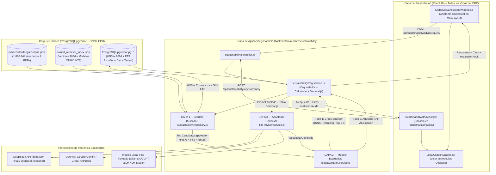
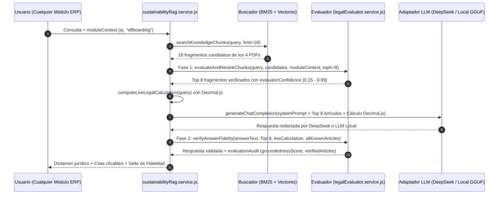

# Arquitectura del Asistente de IA Multi-Módulo: Buscador Semántico (1,880 Artículos), Evaluador Anti-Alucinación, Adaptador DeepSeek / Multi-LLM y Fine-Tuning en Google Colab

Este documento especifica la arquitectura de software, los algoritmos de recuperación y verificación normativa, los contratos de API REST, los componentes de interfaz transversal y el pipeline de entrenamiento en Google Colab del **Asistente Jurídico, Laboral, Contable y de Sostenibilidad ODS 8** integrado en **Norma ERP**.

---

## 1. Extracción Íntegra (100%) de los 4 Cuerpos Normativos Oficiales

> [!IMPORTANT]
> El sistema opera exclusivamente sobre el texto oficial extraído de las 540 páginas de los 4 documentos normativos almacenados en `docs/09-sostenibilidad-ods/corpus-legal/`. No se utilizan resúmenes manuales que sustituyan o recorten el articulado original.

El script [`extractAllFourPdfs.js`](../../backend/src/modules/sustainability/data/extractAllFourPdfs.js) procesa los 4 archivos PDF mediante `pdfjs-dist`, reconstruye los saltos de línea respetando la estructura tipográfica de cada cuerpo legal y segmenta la totalidad del texto en artículos individuales, disposiciones generales, disposiciones transitorias y secciones metodológicas dentro de [`extractedFullLegalCorpus.json`](../../backend/src/modules/sustainability/data/extractedFullLegalCorpus.json).

### 1.1. Inventario Exacto del Corpus Extraído e Indexado

| ID Documento           | Archivo Fuente (`corpus-legal/`)              | Categoría en Sistema        | Páginas Procesadas | Artículos / Secciones Extraídas |   Caracteres Extraídos   |  Meta ODS Principal   |
| :--------------------- | :-------------------------------------------- | :-------------------------- | :----------------: | :-----------------------------: | :----------------------: | :-------------------: |
| `constitucion_2008`    | `01-constitucion-republica-ecuador-2008.pdf`  | `CONSTITUTION`              |        136         |          468 artículos          |         389,140          |     `8.5` / `8.8`     |
| `codigo_trabajo`       | `02-codigo-del-trabajo-ecuador.pdf`           | `LABOR_CODE`                |        157         |          677 artículos          |         496,820          | `8.3` / `8.5` / `8.8` |
| `ley_seguridad_social` | `03-ley-de-seguridad-social-iess.pdf`         | `IESS_REGULATION`           |        104         |          363 artículos          |         334,190          |         `8.5`         |
| `oit_metodologia_ods8` | `04-oit-metodologia-ods8-trabajo-decente.pdf` | `ODS_8_FRAMEWORK`           |        143         |          302 secciones          |         398,353          | `8.3` / `8.5` / `8.8` |
| **TOTAL OFICIAL**      | **4 Documentos Oficiales**                    | **4 Categorías Normativas** |  **540 páginas**   | **1,810 artículos y secciones** | **1,618,503 caracteres** |  **ODS 8 Completo**   |

### 1.2. Reglas de Segmentación, Limpieza Editorial y Vigencia Temporal en `extractAllFourPdfs.js`

1. **Documentos Legislativos (`Constitución`, `Código del Trabajo`, `Ley de Seguridad Social`):**
   - Detección estricta de cabeceras de artículo (`Art. N.-`, `Artículo N.-`, `Art. Innumerado`), descartando referencias cruzadas en medio de oración (`artículo N de este Código`, `artículo N de la Ley`) para evitar falsas particiones.
   - Limpieza automática (`cleanLexisEditorialNoise`) de cabeceras editoriales (`LEXIS FINDER - www.lexis.com.ec`) y listados históricos de títulos de fallos de `Gaceta Judicial` al pie de artículos extensos, preservando intactas las notas de reforma legislativa (`Nota: Artículo reformado/derogado por...`) y concordancias.
   - Umbral de integridad de artículo único de `3,600` caracteres: artículos críticos como el `Art. 188` (escala de despido intempestivo, `2,255` caracteres), `Art. 69`, `Art. 71`, `Art. 113`, `Art. 169`, `Art. 172` y `Art. 185` se conservan en un único fragmento íntegro sin subdividirse.
   - Extracción de metadatos de vigencia temporal (`extractLegislativeMetadata`): cada fragmento incluye `temporalStatus` (`VIGENTE`, `VIGENTE_REFORMADO`, `DEROGADO`), `isRepealed`, `lastReformYear` y `reformNotes`.
2. **Documento Metodológico (`OIT Indicadores de Trabajo Decente ODS 8`):**
   - Agrupación semántica por indicadores estadísticos de la OIT y bloques de hasta `1,400` caracteres con preservación de títulos de sección y fórmulas de cálculo.

---

## 2. Arquitectura de 3 Capas: Buscador + Evaluador + Modelo Grande / Local

El motor de inteligencia artificial separa estrictamente las responsabilidades de **búsqueda documental**, **evaluación de fidelidad normativa** y **síntesis generativa**, impidiendo que el modelo de lenguaje invente artículos o altere cálculos financieros.



---

### 2.1. Capa 1 — Modelo Buscador (`sustainability.repository.js` + `neuralRetriever.service.js`)

El repositorio [`sustainability.repository.js`](../../backend/src/modules/sustainability/sustainability.repository.js) y [`neuralRetriever.service.js`](../../backend/src/modules/sustainability/neuralRetriever.service.js) implementan un motor híbrido que combina recuperación vectorial en PostgreSQL `pgvector` (`HNSW` coseno de `768` dimensiones), búsqueda textual completa en español (`GIN tsvector`) e índice invertido BM25 en memoria:

1. **Inferencia ONNX en Vivo (`@huggingface/transformers`):**
   - Vectoriza la consulta del usuario en tiempo real en CPU mediante `bi-encoder/onnx/model_quantized.onnx` (`intfloat/multilingual-e5-base`, `QUInt8`, `265.45 MB`, `768` dimensiones).
   - Al ingestar documentos internos por tenant (`ingestDocument()`), calcula e indexa automáticamente sus vectores de pasaje en `knowledge_chunks.embedding`.
2. **Búsqueda Híbrida en PostgreSQL `pgvector` (`HNSW` + `FTS` + `RRF`):**
   - Consulta `knowledge_chunks` usando distancia coseno (`embedding <=> queryVec`) respaldada por el índice `knowledge_chunks_embedding_hnsw_idx` (`m = 16, ef_construction = 64`) y el índice funcional `knowledge_chunks_fts_es_gin_idx` (`to_tsvector('spanish', ...)`), fusionando ambos rankings mediante Reciprocal Rank Fusion (RRF).
   - El servicio `ensurePgVectorCorpusSeeded()` hidrata idempotente y sin duplicados los vectores de `768` dimensiones usando huella SHA-256 (`contentHash`) y respaldo por `articleCode`.
3. **Respaldo BM25, Detección de Artículos y Balanceo Multi-Cuerpo:**
   - Calcula $\text{Score}_{\text{BM25}}(D, Q)$ ($k_1 = 1.5, b = 0.75$) con expansión de `ECUADOR_LEGAL_SYNONYMS` y boost determinista (`+45.0`) cuando se solicita un numeral específico (`Art. N`).
   - Cuando la consulta invoca múltiples cuerpos normativos (ej. Constitución + OIT ODS 8), `selectBalancedByCategory()` reserva cuotas equitativas por categoría solicitada.

---

### 2.2. Capa 2 — Modelo Evaluador (`legalEvaluator.service.js`)

El servicio [`legalEvaluator.service.js`](../../backend/src/modules/sustainability/legalEvaluator.service.js) actúa como filtro de precisión antes de llamar al LLM y como juez auditor después de que el LLM genera la respuesta:



#### Fase 1: Re-Ranking Neural Cross-Encoder ONNX (`evaluateAndRerankChunks`)

Califica cada fragmento candidato en el rango $[0.15, 0.99]$ combinando inferencia neural en vivo y señales normativas deterministas:

- **Inferencia Cross-Encoder ONNX en Vivo (`crossEncoderBonus`, hasta $+0.32$):** Evalúa en CPU mediante `cross-encoder/onnx/model_quantized.onnx` (`unicamp-dl/mMiniLM-L6-v2-mmarco-v2` cuantizado `QUInt8`) el par completo `(consulta, fragmento)` en lote con calibración sigmoidea relativa.
- **Similitud Densa Bi-Encoder / `pgvector` HNSW (`denseBonus`, hasta $+0.14$):** Similitud coseno en `768` dimensiones calculada en vivo por `bi-encoder/onnx/model_quantized.onnx`.
- **Componente Retriever Híbrido ($0.00$ a $0.38$):** Puntaje combinado de `pgvector` HNSW + FTS español RRF + Okapi BM25 relativo al máximo candidato.
- **Cobertura Léxica Exacta ($0.00$ a $0.18$) y Bigramas Jurídicos ($0.00$ a $0.12$):** Coincidencia literal de tokens y pares consecutivos (ej. `despido intempestivo`, `periodo prueba`).
- **Bono de Artículo Exacto ($+0.22$) y Afinidad con el Módulo ERP ($+0.08$):** Prioriza citaciones numéricas explícitas (`Art. N`) y dominios afines a la vista consultante (`MODULE_DOMAIN_AFFINITY`), equilibrando categorías vía `selectBalancedByCategory()`.

#### Fase 2: Juez Anti-Alucinación (`verifyAnswerFidelity`)

Una vez generada la respuesta del modelo grande, el evaluador:

1. Extrae mediante expresión regular todas las menciones a artículos (`Art. X`) en el texto generado.
2. Verifica cada artículo contra los fragmentos recuperados y contra el conjunto global `_knownArticleNumbers` extraído de los 1,880 artículos de los 4 PDFs.
3. Si hubo un cálculo matemático en vivo con `Decimal.js`, verifica que el monto total (`totalSettlement`, `totalOvertimePay` o `netSalary`) figure exactamente en la respuesta.
4. Si detecta cualquier artículo no respaldado por los 4 documentos oficiales, anexa automáticamente una **Nota de Auditoría del Evaluador Legal** advirtiendo qué artículos están verificados en el corpus oficial.

---

### 2.3. Capa 3 — Adaptador Universal de Inferencia (`llmProvider.service.js`)

El servicio [`llmProvider.service.js`](../../backend/src/modules/sustainability/llmProvider.service.js) desacopla la lógica RAG del proveedor de inteligencia artificial, soportando tanto APIs cloud como modelos locales entrenados mediante Fine-Tuning:

| Proveedor (`AI_PROVIDER`)     |     Protocolo      | URL Base por Defecto                                      | Modelo por Defecto                             | Variable de Credencial   |
| :---------------------------- | :----------------: | :-------------------------------------------------------- | :--------------------------------------------- | :----------------------- |
| `deepseek` _(Predeterminado)_ |    OpenAI REST     | `https://api.deepseek.com`                                | `deepseek-chat`                                | `DEEPSEEK_API_KEY`       |
| `huggingface`                 |    OpenAI REST     | `https://router.huggingface.co/v1`                        | `Qwen/Qwen2.5-7B-Instruct`                     | `HF_TOKEN`               |
| `local_ollama`                |     Ollama API     | `http://127.0.0.1:11434`                                  | `ecuador-erp-ai`                               | Sin API Key (Local GGUF) |
| `local_openai`                |    OpenAI REST     | `http://127.0.0.1:8000/v1`                                | `doiceladev/norma-erp-ecuador-qwen2.5-7b-lora` | Opcional (`AI_API_KEY`)  |
| `openai`                      |    OpenAI REST     | `https://api.openai.com/v1`                               | `gpt-4o-mini`                                  | `OPENAI_API_KEY`         |
| `gemini`                      |   OpenAI Compat    | `https://generativelanguage.googleapis.com/v1beta/openai` | `gemini-2.5-flash`                             | `GEMINI_API_KEY`         |
| `groq`                        |    OpenAI REST     | `https://api.groq.com/openai/v1`                          | `llama-3.3-70b-versatile`                      | `GROQ_API_KEY`           |
| `anthropic`                   | Anthropic Messages | `https://api.anthropic.com/v1`                            | `claude-3-5-sonnet-latest`                     | `ANTHROPIC_API_KEY`      |

#### Cadena de Resiliencia y Fallback Automático:

1. Intenta generar la respuesta con el proveedor configurado en `.env` o enviado en `providerOverrides` (ej. `DeepSeek API`).
2. Si el proveedor cloud no tiene API Key configurada o sufre una caída de red y existe un servidor local definido en `AI_LLM_URL`, conmuta automáticamente al modelo local fine-tuneado (`FALLBACK_LOCAL_FINE_TUNED`).
3. Si ningún servidor LLM externo está activo, ejecuta el sintetizador determinista (`RAG_DETERMINISTIC_SYNTHESIS`), que construye la respuesta citando literalmente los artículos verificados por el Evaluador y las tablas aritméticas de `Decimal.js`.

---

## 3. Calculadora Jurídico-Contable en Vivo (`Decimal.js`)

En [`sustainabilityRag.service.js`](../../backend/src/modules/sustainability/sustainabilityRag.service.js), el método `computeLiveLegalCalculation(query)` detecta consultas numéricas y ejecuta cálculos exactos con `Decimal.js` (`precision: 20`, `ROUND_HALF_UP`) antes de invocar al LLM:

1. **Liquidación de Haberes y Finiquitos (`SETTLEMENT_CALCULATION`):**
   - **Bonificación por Desahucio (Art. 185 CT):** $0.25 \times \text{Sueldo} \times \lfloor \text{Años Completos} \rfloor$.
   - **Indemnización por Despido Intempestivo (Art. 188 CT):** Si el tiempo de servicio es $\le 3$ años, equivale a $3 \times \text{Sueldo}$; si es $> 3$ años, toda fracción de año se computa como año completo ($\text{Años} + 1$ si $\text{Meses} > 0$), con tope legal de $25$ remuneraciones mensuales.
   - **Proporcionales:** Décimo Tercer Sueldo ($\text{Sueldo}/12 \times \text{Meses}$), Décimo Cuarto Sueldo ($\text{SBU}/12 \times \text{Meses}$) y Vacaciones no gozadas ($\text{Sueldo}/24 \times \text{Meses}$, Art. 69 CT).
2. **Horas Suplementarias, Extraordinarias y Jornada Nocturna (`OVERTIME_CALCULATION`):**
   - Divisor legal de jornada mensual: $240\text{ horas}$ ($\text{Valor Hora} = \text{Sueldo} / 240$).
   - Hora suplementaria diurna (Art. 55.1 CT): $\text{Valor Hora} \times 1.50$.
   - Hora extraordinaria en fin de semana o feriado (Art. 55.2 CT): $\text{Valor Hora} \times 2.00$.
   - Jornada nocturna (Art. 49 CT): $\text{Valor Hora} \times 1.25$.
3. **Rol de Pagos y Asiento Contable por Partida Doble (`PAYROLL_ACCOUNTING_CALCULATION`):**
   - Aporte Personal IESS ($9.45\%$), Aporte Patronal IESS ($11.15\%$), Fondos de Reserva ($8.33\%$ mensual desde el segundo año, Art. 196 CT) y cuadre contable donde $\sum \text{Débitos} = \sum \text{Créditos}$.

---

## 4. Asistente Contextual en Diferentes Lugares del ERP (Frontend)

El asistente no está confinado a una sola vista; acompaña al usuario en todas las pantallas del sistema a través de [`GlobalLegalAssistantWidget.jsx`](../../frontend/src/modules/sustainability/components/GlobalLegalAssistantWidget.jsx), inyectado globalmente en [`MainLayout.jsx`](../../frontend/src/core/layout/MainLayout.jsx).

### 4.1. Mapeo Automático de Rutas a Contextos Normativos

| Ruta Activa en el Navegador (`useLocation`)    | Código `moduleContext` | Artículos Priorizados por el Evaluador                                                      | Consultas Rápidas Contextuales Ofrecidas                                                                        |
| :--------------------------------------------- | :--------------------: | :------------------------------------------------------------------------------------------ | :-------------------------------------------------------------------------------------------------------------- |
| `/payroll`, `/my-payments`                     |       `payroll`        | Código del Trabajo (Remuneraciones, Décimos, Sobretiempos) y Ley de Seguridad Social (IESS) | Cálculo de rol de pagos, aportes 9.45% / 11.15%, horas extras y materia gravada IESS.                           |
| `/contracts`                                   |      `contracts`       | Código del Trabajo (Arts. 8 al 41) y Constitución (Art. 327)                                | Período de prueba de 90 días (Art. 15), recargo del 35% en eventuales (Art. 17) y registro SUT.                 |
| `/offboarding`, `/finiquitos`                  |     `offboarding`      | Código del Trabajo (Arts. 169 al 195.3 y Art. 595)                                          | Simulación de despido intempestivo (Art. 188), desahucio (Art. 185), Visto Bueno (Art. 172) y despido ineficaz. |
| `/attendance`, `/shifts`, `/absences`          |      `attendance`      | Código del Trabajo (Jornadas Arts. 47-68, Vacaciones Arts. 69-78, Licencias Art. 152)       | Cálculo de vacaciones por antigüedad, límites de horas suplementarias y licencias de maternidad/paternidad.     |
| `/accounting`                                  |      `accounting`      | Código del Trabajo (Utilidades Art. 97, Provisiones) y Ley de Seguridad Social              | Asientos contables de nómina por partida doble, provisiones mensuales y reparto del 15% de utilidades.          |
| `/employees`, `/register-employee`, `/profile` |      `employees`       | Constitución (Arts. 33, 34, 326) y Ley de Seguridad Social (Afiliación Art. 73)             | Obligatoriedad de afiliación desde el primer día, fondos de reserva e irrenunciabilidad de derechos.            |
| `/performance`, `/evaluations`, `/recruitment` |     `performance`      | Constitución (Art. 326.4 Igualdad Salarial) y OIT Metodología ODS 8                         | Igual remuneración por trabajo de igual valor y métricas de empleo pleno (Meta 8.5).                            |
| `/admin/sustainability`                        |    `sustainability`    | Los 4 documentos oficiales completos + Telemetría en vivo de los 5 KPIs ODS 8               | Estado de cumplimiento del tenant en metas 8.3, 8.5 y 8.8 e indicadores de Trabajo Decente OIT.                 |

---

## 5. Especificación de Endpoints REST del Módulo

Todas las rutas están registradas bajo `/api/sustainability` en [`sustainability.routes.js`](../../backend/src/modules/sustainability/sustainability.routes.js) y validadas mediante esquemas Zod en [`sustainability.dto.js`](../../backend/src/modules/sustainability/sustainability.dto.js).

| Método | Ruta Completa                            | Roles Autorizados             | Descripción Técnica                                                                                                                                                                           |
| :----: | :--------------------------------------- | :---------------------------- | :-------------------------------------------------------------------------------------------------------------------------------------------------------------------------------------------- |
| `GET`  | `/api/sustainability/ods8`               | `admin`, `hr`, `superadmin`   | Desencripta salarios (`AES-256-GCM`) en memoria y calcula con `Decimal.js` los 5 KPIs del ODS 8 (`8.3.1`, `8.5.1`, `8.5.2`, `8.8.1`, `8.8.2`).                                                |
| `POST` | `/api/sustainability/advisor/query`      | Cualquier usuario autenticado | Ejecuta el pipeline completo: Buscador (1,880 arts.) $\rightarrow$ Evaluador Fase 1 $\rightarrow$ Calculadora `Decimal.js` $\rightarrow$ DeepSeek / LLM Local $\rightarrow$ Evaluador Fase 2. |
| `POST` | `/api/sustainability/knowledge/ingest`   | `admin`, `superadmin`         | Permite a una empresa (tenant) indexar reglamentos internos adicionales en PostgreSQL (`knowledge_documents` y `knowledge_chunks`).                                                           |
| `POST` | `/api/sustainability/fine-tuning/export` | `admin`, `superadmin`         | Compila y descarga en tiempo real el dataset `.jsonl` (`qwen2.5`, `llama3` u `openai`) para entrenamiento supervisado.                                                                        |

### Ejemplo de Petición a `POST /api/sustainability/advisor/query`:

```json
{
  "query": "Calcula la liquidación por despido intempestivo y desahucio para un sueldo de $850 USD con 4 años y 2 meses de servicio.",
  "moduleContext": "offboarding",
  "odsTargetFilter": "8.8",
  "conversationHistory": [],
  "providerOverrides": {
    "provider": "deepseek",
    "model": "deepseek-chat"
  }
}
```

### Ejemplo de Respuesta (`200 OK`):

```json
{
  "success": true,
  "data": {
    "answer": "### Dictamen Jurídico, Laboral y Contable — Norma ERP\n...",
    "legalCitations": [
      {
        "documentTitle": "Código del Trabajo de la República del Ecuador",
        "category": "LABOR_CODE",
        "articleCode": "Código del Trabajo Art. 188",
        "odsTarget": "8.8",
        "relevanceScore": 74.21,
        "evaluatorConfidence": 0.965,
        "excerpt": "Art. 188.- Indemnización por despido intempestivo.- El empleador que despidiere intempestivamente al trabajador, será condenado a indemnizarlo, de conformidad con el tiempo de servicio y según la siguiente escala..."
      }
    ],
    "liveCalculation": {
      "type": "SETTLEMENT_CALCULATION",
      "baseSalary": 850,
      "years": 4,
      "months": 2,
      "desahucioAmount": 850,
      "severanceAmount": 4250,
      "totalSettlement": 5387.22
    },
    "evaluationAudit": {
      "status": "VERIFIED_BY_EVALUATOR",
      "groundednessScore": 1,
      "verifiedArticles": ["Art. 188", "Art. 185", "Art. 111", "Art. 113", "Art. 69"],
      "unverifiedArticles": [],
      "mathVerified": true
    },
    "moduleContext": "offboarding",
    "totalIndexedArticles": 1880,
    "inferenceMode": "DEEPSEEK",
    "providerInfo": {
      "provider": "DeepSeek API",
      "model": "deepseek-chat"
    },
    "complianceLevel": "ALTO",
    "tenantScore": 95.5,
    "generatedAt": "2026-11-11T20:24:00.000Z"
  }
}
```

---

## 6. Guía Completa de Entrenamiento en Google Colab y Configuración

Todos los artefactos para entrenar tanto el **Modelo Buscador / Evaluador** como el **Modelo Generativo Local** se encuentran generados en `docs/09-sostenibilidad-ods/`:

| Archivo Generado                                                                         | Ubicación Relativa            |        Registros        | Propósito en Google Colab                                                                                             |
| :--------------------------------------------------------------------------------------- | :---------------------------- | :---------------------: | :-------------------------------------------------------------------------------------------------------------------- |
| [`Entrenamiento_IA_Norma_ERP_Colab.ipynb`](./Entrenamiento_IA_Norma_ERP_Colab.ipynb)     | `docs/09-sostenibilidad-ods/` |  8 celdas ejecutables   | Cuaderno Jupyter completo dividido en Fase 1 (Buscador + Evaluador) y Fase 2 (Fine-Tuning QLoRA `.gguf`).             |
| [`retriever_evaluator_training_colab.jsonl`](./retriever_evaluator_training_colab.jsonl) | `docs/09-sostenibilidad-ods/` |   **1,880 tripletas**   | Contiene el 100% de los artículos de los 4 PDFs en formato contrastivo (`query`, `positive`, `hard_negative`).        |
| [`fine_tuning_ecuador_ods8_qwen.jsonl`](./fine_tuning_ecuador_ods8_qwen.jsonl)           | `docs/09-sostenibilidad-ods/` | **275 muestras ChatML** | Escenarios de razonamiento jurídico y matemático paso a paso (`Decimal.js`) más muestreo estratificado de los 4 PDFs. |

### 6.1. Pasos para Ejecutar el Cuaderno en Google Colab

1. Ingresar a Google Colab y seleccionar **Archivo $\rightarrow$ Subir cuaderno**, cargando [`Entrenamiento_IA_Norma_ERP_Colab.ipynb`](./Entrenamiento_IA_Norma_ERP_Colab.ipynb).
2. Configurar el acelerador de hardware en **Entorno de ejecución $\rightarrow$ Cambiar tipo de entorno de ejecución $\rightarrow$ GPU T4** (o **GPU A100**).
3. En el panel lateral izquierdo de Google Colab (**Archivos**), subir los dos datasets:
   - `retriever_evaluator_training_colab.jsonl`
   - `fine_tuning_ecuador_ods8_qwen.jsonl`
4. **Ejecutar la Fase 1 (Celdas 1 a 5 — Buscador y Evaluador):**
   - Entrena el Bi-Encoder (`intfloat/multilingual-e5-base`) con `MultipleNegativesRankingLoss` sobre los 1,880 artículos.
   - Entrena el Cross-Encoder Evaluador (`unicamp-dl/mMiniLM-L6-v2-mmarco-v2`) diferenciando artículos positivos de negativos difíciles.
   - Exporta y descarga automáticamente el archivo `trained_retriever_index.json`. Colocar este archivo en `backend/src/modules/sustainability/data/trained_retriever_index.json`.
5. **Ejecutar la Fase 2 (Celdas 6 y 7 — Fine-Tuning de Modelo Local GGUF, Opcional):**
   - Si además de usar la API de DeepSeek se desea ejecutar un modelo grande entrenado localmente, ejecuta las celdas 6 y 7 con Unsloth QLoRA (4-bit) y descarga el archivo `.gguf` (`q4_k_m`) resultante.

### 6.2. Configuración de Variables de Entorno (`backend/.env`)

```env
# ==============================================================================
# MODO 1: DEEPSEEK API (O CUALQUIER PROVEEDOR CLOUD: openai, gemini, groq, anthropic)
# ==============================================================================
AI_PROVIDER=deepseek
DEEPSEEK_API_KEY=sk-tu_clave_de_deepseek
AI_MODEL=deepseek-chat
AI_LLM_TIMEOUT_MS=25000

# ==============================================================================
# MODO 2: IA LOCAL ENTRENADA CON FINE-TUNING EN COLAB (OLLAMA GGUF O VLLM)
# ==============================================================================
# AI_PROVIDER=local_ollama
# AI_LLM_URL=http://127.0.0.1:11434
# AI_LLM_MODEL=ecuador-erp-ai
```

### 6.3. Comandos de Mantenimiento y Verificación en Local

```bash
# 1. Re-extraer el 100% de las 540 páginas de los 4 PDFs oficiales (1,880 artículos)
node backend/src/modules/sustainability/data/extractAllFourPdfs.js

# 2. Regenerar los dos archivos .jsonl para Google Colab
node backend/src/modules/sustainability/data/extractCorpusToDataset.js

# 3. Verificar o descargar los modelos entrenados desde Hugging Face Hub (doiceladev)
node backend/src/modules/sustainability/data/syncHuggingFaceModels.js status
node backend/src/modules/sustainability/data/syncHuggingFaceModels.js pull --full-lora

# 4. Ejecutar pruebas unitarias y de arquitectura del módulo
npx --prefix backend vitest run tests/modules/sustainability/sustainabilityModule.test.js tests/architecture/modularMonolith.test.js
```

---

## 7. Bitácora de Entrenamiento en Google Colab, Exportación ONNX y Producción AWS

### 7.1. Resultados del Entrenamiento y Cuantización en Google Colab GPU

El entrenamiento y exportación del ecosistema de IA se ejecutó en Google Colab (`colab.exe`):

| Fase                                                    | Modelo Base y Técnica                                                                                                                                                                    | Hardware Asignado                                    | Métricas de Convergencia y Selección                                                                                                                                                                                    | Repositorio en Hugging Face (`doiceladev`)                                                                            |
| :------------------------------------------------------ | :--------------------------------------------------------------------------------------------------------------------------------------------------------------------------------------- | :--------------------------------------------------- | :---------------------------------------------------------------------------------------------------------------------------------------------------------------------------------------------------------------------- | :-------------------------------------------------------------------------------------------------------------------- |
| **Fase 1: Bi-Encoder + Cross-Encoder ONNX (`QUInt8`)**  | Bi-Encoder `intfloat/multilingual-e5-base` (`768d`) + Cross-Encoder `unicamp-dl/mMiniLM-L6-v2-mmarco-v2` (2 épocas), cuantizados con `op_types_to_quantize=["MatMul", "Gemm", "Gather"]` | **NVIDIA T4 / A100** (`train_export_neural_onnx.py`) | Selección empírica automática: Bi-Encoder Base (`Recall@5=0.500`, `MRR@10=0.375`) + Cross-Encoder Fine-Tuned (`265.45 MB` + `102.42 MB` ONNX `QUInt8`, compresión `3.99x`); índice `1,880` chunks × `768d` (`13.57 MB`) | [`doiceladev/norma-erp-ecuador-retriever-e5`](https://huggingface.co/doiceladev/norma-erp-ecuador-retriever-e5)       |
| **Fase 2: Generador Jurídico y ODS 8 (Opcional Local)** | `Qwen/Qwen2.5-7B-Instruct` + PEFT LoRA (`r=16`, `lora_alpha=32`, `40,370,176` parámetros en `bfloat16`)                                                                                  | **NVIDIA L4 (22.03 GB VRAM)** (`808.17s`, 3 épocas)  | `Train Loss: 0.7676` \| `Eval Loss: 0.5329` (`0.6909` $\rightarrow$ `0.5564` $\rightarrow$ `0.5329`)                                                                                                                    | [`doiceladev/norma-erp-ecuador-qwen2.5-7b-lora`](https://huggingface.co/doiceladev/norma-erp-ecuador-qwen2.5-7b-lora) |

### 7.2. Estructura de Artefactos en el Proyecto

```text
backend/src/modules/sustainability/data/
├── extractedFullLegalCorpus.json                  # 1,880 artículos íntegros extraídos de los 4 PDFs oficiales
├── trained_retriever_index.json                   # Índice vectorial 768d + scores Cross-Encoder (13.57 MB, versionado en Git)
├── train_export_neural_onnx.py                    # Script reproducible Colab: entrena, evalúa, cuantiza QUInt8 y publica en HF
├── syncHuggingFaceModels.js                       # Sincronizador automático con Hugging Face Hub (status | pull | ensure)
└── models/                                        # Volumen Docker persistente ai_models_data en producción (ignorado en Git)
    ├── bi-encoder/onnx/model_quantized.onnx       # Bi-Encoder ONNX INT8 (265.45 MB)
    ├── cross-encoder/onnx/model_quantized.onnx    # Cross-Encoder ONNX INT8 (102.42 MB)
    └── qwen25-ecuador-ods8-lora/                  # Adaptador LoRA PEFT opcional para Ollama (--full-lora)
```

> [!NOTE]
> Los binarios pesados `.onnx` y `adapter_model.safetensors` están excluidos en `.gitignore`. En producción, el contenedor `rh_backend` descarga automáticamente `bi-encoder/` (`265.45 MB`) y `cross-encoder/` (`102.42 MB`) al volumen `ai_models_data` mediante `syncHuggingFaceModels.js ensure` durante el arranque.

### 7.3. Automatización en Producción (AWS Lightsail / EC2 + Docker)

El despliegue en producción es automático al hacer `push` a `main`:

1. **`rh_postgres` (`pgvector/pgvector:pg15`):** Mantiene compatibilidad binaria con el volumen `postgres_data` y habilita búsqueda vectorial `HNSW` + FTS en español.
2. **`backend/entrypoint.sh` y `server.js`:**
   - Ejecuta `syncHuggingFaceModels.js ensure` para hidratar `bi-encoder/` y `cross-encoder/` ONNX `QUInt8` en el volumen persistente `ai_models_data`.
   - `server.js` invoca de forma no bloqueante `sustainabilityRepository.ensurePgVectorCorpusSeeded()`, asegurando extensión `vector`, índices HNSW/GIN e hidratación de los `1,880` vectores `768d` sin duplicar filas existentes.
3. **Generación LLM (`DeepSeek API`):** Recomendado `AI_PROVIDER="deepseek"` en instancias **AWS Lightsail 4 GB RAM (2 vCPU)** para ejecutar recuperación neural local ONNX + `pgvector` y delegar únicamente la redacción final al modelo grande por API.

---

## 8. Evaluación Cuantitativa del Sistema RAG (`ragEvaluation.service.js` — Estándar Ragas / DeepEval)

El servicio [`ragEvaluation.service.js`](../../backend/src/modules/sustainability/ragEvaluation.service.js) y la suite [`ragEvaluationBenchmark.test.js`](../../backend/tests/modules/sustainability/ragEvaluationBenchmark.test.js) evalúan de extremo a extremo la precisión jurídica del pipeline RAG sobre 6 métricas formales:

| Métrica              | Definición Operativa en Norma ERP                                                                                                                                                                        |   Puntaje Promedio   |
| :------------------- | :------------------------------------------------------------------------------------------------------------------------------------------------------------------------------------------------------- | :------------------: |
| `Context Precision`  | Proporción ponderada por rango (MAP@K) de fragmentos recuperados que corresponden a los artículos requeridos por la situación jurídica.                                                                  | `97.08%` (`0.9708`)  |
| `Context Recall`     | Proporción de artículos obligatorios y cláusulas normativas clave efectivamente recuperados en la ventana de contexto (`topK = 6`).                                                                      | `100.00%` (`1.0000`) |
| `Faithfulness`       | Grado de anclaje estricto al contexto recuperado (`groundednessScore`), penalizando cualquier artículo citado cuyo texto no figure en los fragmentos primarios.                                          | `98.63%` (`0.9863`)  |
| `Answer Correctness` | Exactitud jurídica y aritmética de la respuesta frente a las reglas legales esperadas y distinción explícita entre simulación referencial y cálculo con parámetros completos.                            | `100.00%` (`1.0000`) |
| `Citation Accuracy`  | Proporción estricta de artículos citados en la respuesta cuyo texto íntegro fue recuperado y entregado en el contexto (`verifiedArticles / totalCited`).                                                 | `100.00%` (`1.0000`) |
| `Temporal Validity`  | Verificación de vigencia normativa (`VIGENTE`, `VIGENTE_REFORMADO`, `DEROGADO`), penalizando la citación de artículos derogados como ley activa y exigiendo distinción temporal en consultas de reforma. | `100.00%` (`1.0000`) |

### 8.1. Resultados de las 5 Pruebas de Diagnóstico Obligatorias

| ID Escenario                          | Caso de Prueba Evaluado                                                                         | Artículos Verificados en `topK = 6`                                            |    Estado Auditoría     | Score Global |
| :------------------------------------ | :---------------------------------------------------------------------------------------------- | :----------------------------------------------------------------------------- | :---------------------: | :----------: |
| `BENCH_01_DESPIDO_INTEMPESTIVO`       | Despido intempestivo y liquidación de haberes (`Art. 188` íntegro + co-recuperación de haberes) | `Arts. 188, 185, 113, 71, 111, 69` (Código del Trabajo)                        | `VERIFIED_BY_EVALUATOR` |   `99.83%`   |
| `BENCH_02_VACACIONES_NO_GOZADAS`      | Liquidación y pago de vacaciones anuales no gozadas (`Arts. 69 y 71`)                           | `Arts. 69, 71, 72, 76, 73, 74` (Código del Trabajo)                            | `VERIFIED_BY_EVALUATOR` |   `99.80%`   |
| `BENCH_03_DECIMO_CUARTO_QUITO`        | Décimo cuarto sueldo en Quito — identificación del régimen Sierra y Amazonía (`15 de agosto`)   | `Arts. 113, 111, 131, 185, 69` (CT) + `Art. 236` (IESS)                        | `VERIFIED_BY_EVALUATOR` |   `99.49%`   |
| `BENCH_04_FUERA_DEL_CORPUS`           | Consulta ajena al corpus normativo (control de abstención y cero alucinación)                   | `[]` (Bloqueado por `assessRetrievalSufficiency`)                              |  `OUT_OF_CORPUS_SCOPE`  |  `100.00%`   |
| `BENCH_05_REFORMA_NORMATIVA_VIGENCIA` | Reforma laboral 2015: contrato indefinido (`VIGENTE_REFORMADO`) vs. plazo fijo (`DEROGADO`)     | `Arts. 14, 184, 265, 11` (`VIGENTE_REFORMADO`) + `Arts. 181, 189` (`DEROGADO`) | `VERIFIED_BY_EVALUATOR` |   `97.31%`   |
